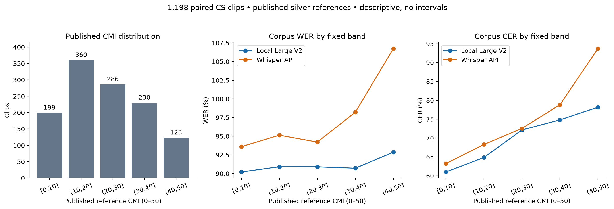
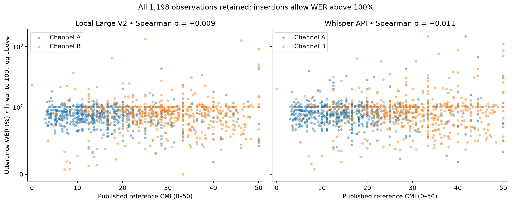
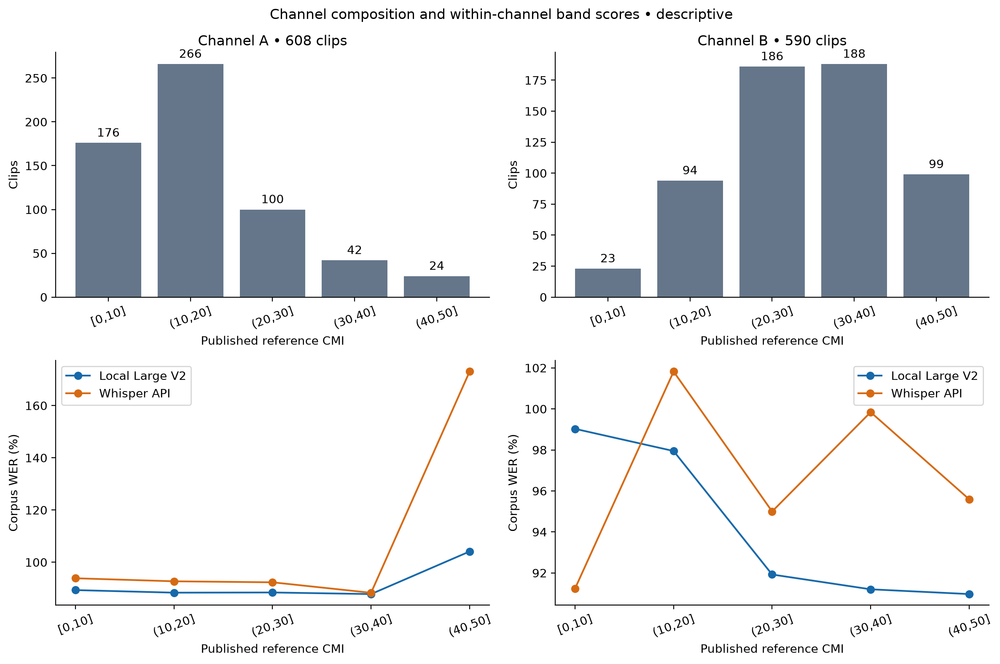
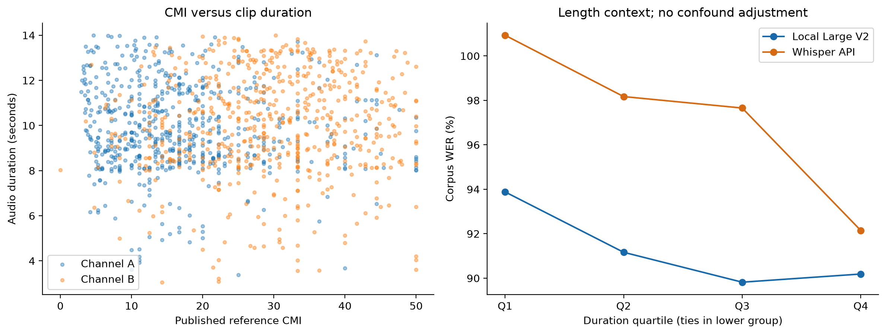

# CMI analysis — November 16, 2026

November 18 work completed early, using the frozen protocol and saved predictions only. No new transcription, network request or credential access.

## Fixed published-CMI bands

CMI measures bilingual balance (0–50), not switch frequency or simply the English percentage. Published CMI is based on source script labels. Scores retain mixed-script references and use the frozen normalization. Corpus WER/CER sum edit counts and divide by summed reference words/characters; they are not averages of utterance rates.

| Group | Clips | Videos | Words | Mean CMI | Local WER | API WER | Local CER | API CER |
|---|---:|---:|---:|---:|---:|---:|---:|---:|
| [0,10] | 199 | 15 | 4478 | 6.74 | 90.22% | 93.61% | 61.03% | 63.24% |
| (10,20] | 360 | 19 | 7975 | 15.23 | 90.92% | 95.15% | 64.85% | 68.32% |
| (20,30] | 286 | 20 | 7217 | 25.25 | 90.91% | 94.22% | 72.14% | 72.55% |
| (30,40] | 230 | 20 | 5843 | 35.00 | 90.72% | 98.22% | 74.82% | 78.82% |
| (40,50] | 123 | 22 | 2703 | 45.17 | 92.86% | 106.73% | 78.16% | 93.68% |



## Continuous descriptive associations

Spearman uses per-clip rates, with tied ranks. Positive rho means higher values co-occur; it does not establish a causal mixing effect. Undefined correlations are recorded as null. No p-values, significance decisions or intervals are produced in this step.

| Variables | Spearman rho |
|---|---:|
| cmi_vs_local_wer | +0.0093 |
| cmi_vs_local_cer | +0.2698 |
| cmi_vs_whisper_api_wer | +0.0109 |
| cmi_vs_whisper_api_cer | +0.2514 |
| cmi_vs_local_minus_api_wer | -0.0204 |
| cmi_vs_duration | +0.0236 |
| cmi_vs_reference_words | +0.0533 |
| duration_vs_local_wer | -0.0935 |
| duration_vs_whisper_api_wer | -0.1246 |

For local-minus-API WER, a positive difference means more local error. The correlation of this difference is distinct from the difference between two corpus rates.



## Channel and video composition

The source speaker_id identifies a channel, not an independently identified speaker. Two channels and 22 videos limit generalization. Descriptive conditioning does not remove confounding.

| Group | Clips | Videos | Words | Mean CMI | Local WER | API WER | Local CER | API CER |
|---|---:|---:|---:|---:|---:|---:|---:|---:|
| Channel A | 608 | 3 | 13189 | 16.85 | 89.09% | 95.09% | 62.20% | 67.52% |
| Channel B | 590 | 19 | 15027 | 29.50 | 92.59% | 97.58% | 75.36% | 77.96% |

| Channel | CMI–local WER rho | CMI–API WER rho |
|---|---:|---:|
| Channel A | -0.0169 | -0.0080 |
| Channel B | -0.0535 | -0.0503 |

| Channel | CMI–local CER rho | CMI–API CER rho |
|---|---:|---:|
| Channel A | +0.2891 | +0.3048 |
| Channel B | +0.0452 | +0.0145 |

Channel IDs: `Channel A` = `UChx9-bynjfm6Js3k54Sf1Mg`; `Channel B` = `UCy-Q66KQYSQAUVKvdNxgKbw`.



Per-video summaries (not independent clip samples):

| Group | Clips | Videos | Words | Mean CMI | Local WER | API WER | Local CER | API CER |
|---|---:|---:|---:|---:|---:|---:|---:|---:|
| -3PhO-CA2iw | 8 | 1 | 188 | 21.51 | 72.87% | 71.28% | 64.78% | 66.40% |
| 9SSyraZ2F2w | 160 | 1 | 3104 | 18.65 | 87.05% | 101.26% | 60.85% | 75.21% |
| 9t3HtETn0JA | 46 | 1 | 1422 | 25.02 | 88.12% | 87.76% | 70.31% | 66.42% |
| BbGvIkTR0ME | 15 | 1 | 401 | 30.12 | 76.31% | 78.80% | 69.87% | 72.65% |
| HQJoP3X6UdY | 34 | 1 | 533 | 31.11 | 117.45% | 100.56% | 101.72% | 86.96% |
| HUfMJuhOj5w | 72 | 1 | 719 | 27.06 | 126.70% | 172.60% | 112.40% | 162.21% |
| IPiEm1_ZaU4 | 51 | 1 | 1565 | 29.61 | 90.67% | 99.94% | 71.48% | 74.78% |
| LhDdCCqBt4A | 40 | 1 | 1179 | 32.03 | 88.46% | 99.92% | 67.31% | 74.24% |
| Mnm3U3UlPPU | 22 | 1 | 353 | 32.07 | 80.45% | 111.05% | 68.23% | 81.23% |
| P9dy-ECijcI | 279 | 1 | 6562 | 15.84 | 88.97% | 91.74% | 61.43% | 61.32% |
| TftKf_L-qBA | 20 | 1 | 295 | 26.44 | 95.93% | 102.03% | 88.77% | 93.71% |
| bZFcrpg-tlo | 26 | 1 | 738 | 28.02 | 64.09% | 76.96% | 54.85% | 61.24% |
| d_ti-m5_s3s | 22 | 1 | 731 | 34.17 | 82.76% | 81.81% | 64.68% | 63.99% |
| eygbRVIhiJw | 1 | 1 | 30 | 46.67 | 86.67% | 86.67% | 68.79% | 71.97% |
| fT_Ued7BDDo | 44 | 1 | 1487 | 31.64 | 88.10% | 88.10% | 74.58% | 65.99% |
| gtFNwgkYeXE | 10 | 1 | 280 | 28.32 | 102.50% | 95.36% | 79.19% | 69.40% |
| hDWNurAsWSE | 25 | 1 | 473 | 30.81 | 89.43% | 93.87% | 75.55% | 89.54% |
| qNsZlWl3yss | 30 | 1 | 871 | 30.19 | 108.04% | 91.04% | 78.91% | 68.82% |
| sGhq22Tx5ew | 169 | 1 | 3523 | 16.83 | 91.12% | 95.88% | 64.79% | 72.56% |
| tfaFVT7CFiE | 1 | 1 | 41 | 48.78 | 100.00% | 100.00% | 93.78% | 93.78% |
| yTZL86j1yRE | 68 | 1 | 2062 | 32.89 | 86.76% | 89.14% | 69.94% | 68.32% |
| zYLanqYoX24 | 55 | 1 | 1659 | 26.11 | 105.85% | 112.60% | 90.21% | 98.39% |

## Duration and reference length

Duration quartile cutpoints: 8.608, 9.872, 11.552 seconds. These are descriptive reporting groups, not frozen CMI bins. Ties go in the lower group; no clip is discarded.

| Group | Clips | Videos | Words | Mean CMI | Local WER | API WER | Local CER | API CER |
|---|---:|---:|---:|---:|---:|---:|---:|---:|
| Q1 | 306 | 21 | 5051 | 23.79 | 93.88% | 100.93% | 72.96% | 78.03% |
| Q2 | 295 | 20 | 5795 | 21.38 | 91.16% | 98.17% | 70.37% | 75.51% |
| Q3 | 298 | 20 | 7465 | 23.38 | 89.82% | 97.66% | 67.04% | 76.19% |
| Q4 | 299 | 21 | 9905 | 23.74 | 90.19% | 92.15% | 69.42% | 67.87% |

Full min/median/mean/max CMI, duration and reference-word distributions are in the JSON for every band, channel, video and duration group.



## Same-50 reference and lexical-CMI sensitivity

This balanced diagnostic subset is not population-representative. Published condition uses source CMI/published references; corrected condition uses human lexical CMI/corrected references. Both labels and reference definitions can change, while hypotheses remain fixed. This does not isolate the causal effect of either change. One reviewer checked script suggestions; these are operational references, not independent gold truth.

### Published condition

| Group | Clips | Videos | Words | Mean CMI | Local WER | API WER | Local CER | API CER |
|---|---:|---:|---:|---:|---:|---:|---:|---:|
| [0,10] | 10 | 8 | 186 | 6.38 | 103.23% | 89.25% | 75.96% | 83.42% |
| (10,20] | 10 | 8 | 186 | 16.60 | 89.78% | 97.31% | 61.86% | 77.00% |
| (20,30] | 10 | 8 | 220 | 24.71 | 83.64% | 101.36% | 60.44% | 78.88% |
| (30,40] | 10 | 8 | 240 | 34.26 | 133.75% | 90.42% | 100.11% | 76.19% |
| (40,50] | 10 | 8 | 142 | 45.05 | 83.10% | 95.07% | 81.17% | 93.29% |

CMI–WER rho: local -0.0197, API -0.1347; paired-difference rho -0.0908.

### Corrected condition

| Group | Clips | Videos | Words | Mean CMI | Local WER | API WER | Local CER | API CER |
|---|---:|---:|---:|---:|---:|---:|---:|---:|
| [0,10] | 11 | 9 | 195 | 5.12 | 98.97% | 93.33% | 73.37% | 93.34% |
| (10,20] | 8 | 6 | 166 | 17.10 | 92.77% | 92.77% | 62.72% | 62.72% |
| (20,30] | 10 | 8 | 220 | 24.95 | 83.64% | 101.36% | 60.44% | 78.88% |
| (30,40] | 13 | 9 | 289 | 35.25 | 126.99% | 91.00% | 99.04% | 78.26% |
| (40,50] | 8 | 8 | 109 | 45.60 | 77.98% | 91.74% | 73.53% | 89.30% |

CMI–WER rho: local +0.0104, API -0.1669; paired-difference rho -0.0174.

## Interpretation and next step

The predeclared clip-level CMI–WER associations are near zero: local rho +0.0093, hosted +0.0109. The paired local-minus-API WER association is also near zero (−0.0204). These results do not support a clear monotonic word-error gradient over this pool; near-zero rho does not rule out nonlinear patterns or subgroup effects.

Corpus WER by fixed band is mostly flat for local (90.22–92.86%). Hosted WER is nonmonotonic, with its highest rate in (40,50]: 106.73%, compared with 93.61% in [0,10]. WER above 100% is possible because insertions count. Weighted corpus band rates and clip-level rank correlations answer different questions, so these observations are compatible.

Character errors show a clearer positive descriptive association: CMI–CER rho +0.2698 local and +0.2514 hosted; corpus CER rises across all five bands for both systems. The channels have different mean CMIs (16.85 versus 29.50), baseline errors and video coverage (3 versus 19 videos). This composition and the script-derived CMI warrant caution: higher CER is not proof that mixing itself caused the errors. High measured errors can reflect recognition and language/script/reference conventions; this step has not classified their causes.

The CER pattern also varies by channel: Channel A rho +0.2891 local / +0.3048 hosted, versus Channel B +0.0452 / +0.0145. Thus the pooled character-error association is not uniform across sources. Duration has little pooled association with CMI (rho +0.0236); that descriptive check does not establish absence of confounding.

The systems have different implementations, decoding and provider internals. This is a configured-system comparison and does not identify a causal effect of hosting. Published references are silver; the 50-clip audit does not validate every reference or source CMI.

Paired video-cluster uncertainty remains the next scheduled task: 2,000 paired video resamples within channels, seed 42, with the frozen minimum-video rule. No confidence intervals or statistical superiority claims are made here. Error-example listening, final report and release also remain.

## Reproduction

```powershell
.\.venv\Scripts\python.exe -m pip install -r requirements-analysis.txt
.\.venv\Scripts\python.exe src/analyze_cmi.py
```

Results: `results/metrics/cmi_analysis_20261116.json`; four figures in both PNG and SVG under `results/figures/`. JSON includes all per-clip edit counts, grouping summaries, dependency versions and frozen-input checksums. Global counts are checked against independently verified runs before writing. Saved predictions, references and protocol are never edited.
