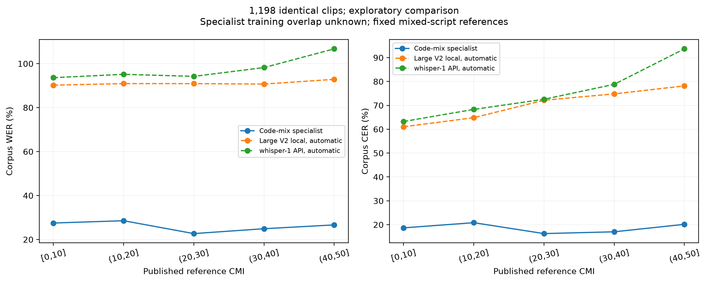

# Exploratory Nepali English code mix model results

**Sanskar Ananta Tiwari · November 27, 2026 · Separate from the published report**

The new fine-tuned Large V3 Turbo completed all **1,198 benchmark clips**. Its normalized corpus WER is **25.94%** and CER **18.42%**. Every saved hypothesis and score passed independent reconstruction/edit-count verification. The original local/API outputs were reused, without new API calls.

**Interpretation:** these scores describe agreement with our fixed mixed-script references. The model was trained partly on the same source dataset; exact training overlap remains unknown. A large observed improvement is not proof of performance on unseen clips or an isolated fine-tuning effect.

## Systems and overall scores

| System | WER | CER | Word edits | Reference words |
|---|---:|---:|---:|---:|
| Code-mix specialist, forced Nepali | 25.94% | 18.42% | 7319 | 28216 |
| Large V2 local, automatic | 90.95% | 69.60% | 25663 | 28216 |
| whisper-1 API, automatic | 96.41% | 73.39% | 27204 | 28216 |
| Large V2 local, forced Nepali | 91.13% | 70.57% | 25712 | 28216 |
| whisper-1 API, forced Nepali | 97.12% | 75.35% | 27403 | 28216 |

WER/CER use the original normalization and sum edits before division; they are not averages of utterance rates. WER is not semantic accuracy, and one minus WER should not be presented as the percentage of correctly understood speech.

## Paired changes and uncertainty

Differences are specialist minus baseline in percentage points; negative means lower specialist error. The existing method resamples source videos within each channel 2,000 times, seed 42, with paired outcomes kept together. Intervals are conditional on two observed channels, 22 videos and fixed references, not training-disjointness or annotation uncertainty.

| Baseline | WER change (pp) | Exploratory 95% interval | CER change (pp) | Exploratory 95% interval |
|---|---:|---|---:|---|
| Large V2 local, automatic | -65.01 | [-68.77, -59.76] | -51.18 | [-54.42, -46.93] |
| whisper-1 API, automatic | -70.47 | [-73.31, -67.05] | -54.97 | [-58.33, -51.78] |
| Large V2 local, forced Nepali | -65.19 | [-68.88, -59.91] | -52.15 | [-54.93, -48.30] |
| whisper-1 API, forced Nepali | -71.18 | [-74.39, -67.75] | -56.93 | [-61.36, -52.92] |

The word "significant" should be separated into effect size and uncertainty. A difference whose interval lies below zero is a consistent observed advantage under this conditional resampling design; it does not remove training-overlap, reference-convention, model-version or implementation confounding.

## Original CMI groups

| Published CMI | Clips | Specialist WER | Specialist CER | Local automatic WER | API automatic WER |
|---|---:|---:|---:|---:|---:|
| [0,10] | 199 | 27.49% | 18.67% | 90.22% | 93.61% |
| (10,20] | 360 | 28.54% | 20.83% | 90.92% | 95.15% |
| (20,30] | 286 | 22.68% | 16.27% | 90.91% | 94.22% |
| (30,40] | 230 | 24.90% | 17.02% | 90.72% | 98.22% |
| (40,50] | 123 | 26.64% | 20.15% | 92.86% | 106.73% |



Descriptive clip-level Spearman association with published CMI: specialist WER -0.0277; CER +0.0066. CMI is a balance measure, not switch frequency; these associations do not establish causation. Band-level paired intervals, channels and the full source-video draws are retained in the JSON. No clips are removed because their scores are high.

## Same 50 human-reviewed references

The separately audited subset is balanced across original CMI bands and is not population representative. Each comparison uses the same reference version for both systems; corrected references can change denominators.

| Reference version | Specialist WER | Specialist CER | Local automatic WER | API automatic WER |
|---|---:|---:|---:|---:|
| published | 30.49% | 24.14% | 100.82% | 94.66% |
| corrected | 29.52% | 23.50% | 100.41% | 94.18% |

## Execution and limits

- Checkpoint: `ailabpvtltd/whisper-large-v3-turbo-nepali-english-codemix-asr`, pinned revision `8eff5c489628694a9f3ff2a02f3225ccfd6c6046`.
- Public BF16 safetensors were checksum-verified and converted to CTranslate2 FP16. Inference used faster-whisper 1.2.1 / CTranslate2 4.8.5 on the laptop GPU, batch one, beam one, temperature zero, Nepali specified, no VAD, transcript prompt or previous-clip context. This is a converted implementation, not a measured equivalence claim with the authors' Transformers pipeline.
- Summed generation time: 9.19 minutes for 199.01 audio minutes; real-time factor 0.046. This excludes setup, downloading, conversion, model loading, scoring and saving overhead.
- Largest whole-device post-transcription memory snapshot: 3587 MiB. Snapshots do not measure exact model peak memory.
- The source checkpoint uses different training and output conventions from general Large V2, including number/symbol spelling. Primary references were not rewritten for the new model. Raw scores and reviewed-reference sensitivity remain separate.
- The original Large V3 Turbo base was not rerun in this experiment. Differences from Large V2/whisper-1 cannot isolate fine-tuning from base-model, decoding or service differences.
- Training included saileshbro/nepali-cs-asr; neither the public model files nor its card establish exclusion of these exact 1,198 clips. Do not describe this as a confirmed unseen-data benchmark.
- Model source and attribution: [AI Lab Pvt. Ltd. pinned model card](https://huggingface.co/ailabpvtltd/whisper-large-v3-turbo-nepali-english-codemix-asr/blob/8eff5c489628694a9f3ff2a02f3225ccfd6c6046/README.md), released under CC BY-NC 4.0. See the separate [feasibility study](codemix_model_feasibility_20261124.md) for the training-data disclosure and local-resource checks.
- No new listening judgments, tolerant word equivalences or semantic-accuracy labels were invented. The ten-example text comparison is a review aid, not an independent listening audit.
- No OpenAI credits were spent by these local runs. The original research PDF, frozen baselines and GitHub publication remain unchanged.

The [full JSON](../results/metrics/codemix_turbo_comparison_20261127.json) records source hashes, edit counts, raw scores, all paired comparisons and uncertainty. The [ten-example comparison](codemix_turbo_examples_20261127.md) shows the existing references and saved outputs without changing the prior annotations.

```powershell
.\.venv\Scripts\python.exe src/run_codemix_experiment.py --split test --execute
.\.cache\reproduction-20261124\env\Scripts\python.exe src/analyze_codemix_experiment.py
```

The runner resumes successful saved clips. Do not delete checkpoints to bypass an unresolved attempt. The analysis performs no model inference or network calls; it independently rechecks the cached WAV identities.
