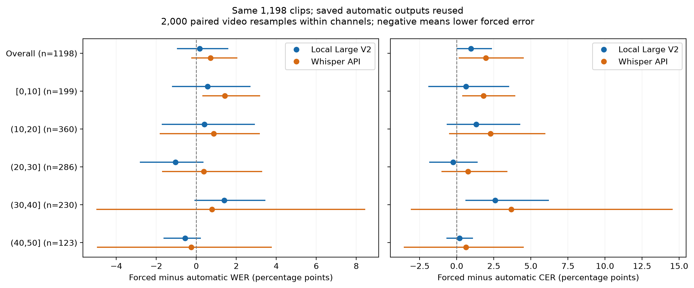

# Forced Nepali versus automatic language — November 24, 2026

Both forced-Nepali systems completed all 1,198 test clips and passed independent verification. This comparison reuses the original automatic outputs and makes no new inference/API calls.

## Plain-language result

Forcing Nepali did not improve either overall exact-transcript score on this dataset. Word and character error rates increased slightly. Individual clips improved, worsened or tied; these are corpus averages, not a claim that every transcript became worse.

## Same 1,198 clips, unchanged references

| System | Automatic WER | Forced WER | Change (pp) | Automatic CER | Forced CER | Change (pp) |
|---|---:|---:|---:|---:|---:|---:|
| Local Large V2 | 90.95% | 91.13% | +0.17 | 69.60% | 70.57% | +0.97 |
| Whisper API | 96.41% | 97.12% | +0.71 | 73.39% | 75.35% | +1.96 |

Positive forced-minus-automatic changes mean more error with forced Nepali. Corpus rates sum edit counts before dividing by the same reference units; they are not averages of per-clip percentages. Strict WER/CER measure agreement with mixed-script silver references, not semantic understanding.

## Paired video uncertainty and CMI groups

The frozen method uses 2,000 video resamples within each of the two observed channels, seed 42. All four outcomes for a video receive the same multiplicity. Intervals are exploratory and conditional on these sources/references. Groups with fewer than ten videos or any zero-denominator draw have no interval.

| Group | Clips | Videos | Local WER change (pp) | 95% interval | API WER change (pp) | 95% interval |
|---|---:|---:|---:|---|---:|---|
| Overall | 1198 | 22 | +0.17 | [-0.97, +1.60] | +0.71 | [-0.25, +2.05] |
| [0,10] | 199 | 15 | +0.56 | [-1.22, +2.72] | +1.43 | [+0.31, +3.19] |
| (10,20] | 360 | 19 | +0.40 | [-1.73, +2.93] | +0.87 | [-1.83, +3.17] |
| (20,30] | 286 | 20 | -1.04 | [-2.82, +0.36] | +0.37 | [-1.72, +3.29] |
| (30,40] | 230 | 20 | +1.40 | [-0.10, +3.45] | +0.79 | [-4.99, +8.45] |
| (40,50] | 123 | 22 | -0.55 | [-1.64, +0.23] | -0.26 | [-4.97, +3.78] |



The local-minus-API difference in the language-setting change is estimated directly from all four paired outcomes. This avoids inferring a difference merely because two separate intervals have different labels.

| Metric | Local change (pp) | 95% interval | API change (pp) | 95% interval | Local change minus API change (pp) | 95% interval |
|---|---:|---|---:|---|---:|---|
| WER | +0.17 | [-0.97, +1.60] | +0.71 | [-0.25, +2.05] | -0.53 | [-2.16, +1.03] |
| CER | +0.97 | [+0.003, +2.38] | +1.96 | [+0.13, +4.52] | -0.99 | [-3.47, +0.92] |

These intervals do not measure provider rerun variability or human-annotation uncertainty. CMI bands are exploratory summaries, not simultaneous confidence intervals or causal mixing effects.

Both overall WER intervals span zero: the small observed increases do not establish a reliable direction for word error under this resampling design. Both CER intervals lie above zero; the local lower bound is extremely close to zero. Both local-minus-API change intervals span zero, so this comparison does not establish that the systems respond differently to the language setting.

## Clip-level changes

| System | Metric | Improved | Tied edit count | Worsened | Identical normalized transcript |
|---|---|---:|---:|---:|---:|
| Local Large V2 | WER | 94 | 1035 | 69 | 953 |
| Local Large V2 | CER | 112 | 983 | 103 | 953 |
| Whisper API | WER | 150 | 936 | 112 | 818 |
| Whisper API | CER | 175 | 867 | 156 | 818 |

Tied edit counts can occur even when output text differs. Improvements/worsenings compare each clip with its own automatic result, using identical reference denominators. There are more improved clips than worsened clips in both systems, but a few larger deteriorations outweigh the smaller improvements in summed word edits. Counting clips and measuring corpus error answer different questions.

## Raw-text sensitivity

The primary scores above retain the original normalization. Raw scores preserve case and punctuation (with the existing whitespace handling). They are sensitivity checks, not substitute primary outcomes.

| System | Automatic raw WER | Forced raw WER | Change (pp) | Automatic raw CER | Forced raw CER | Change (pp) |
|---|---:|---:|---:|---:|---:|---:|
| Local Large V2 | 93.75% | 93.60% | -0.15 | 71.61% | 72.48% | +0.86 |
| Whisper API | 98.76% | 99.15% | +0.39 | 75.37% | 77.24% | +1.88 |

Local raw WER decreases slightly while normalized WER increases slightly. The direction of this small word-error change is sensitive to scoring conventions; neither result implies a measured change in semantic accuracy.

## Fifty-clip reference sensitivity

This separately audited, balanced subset is not representative of the full corpus. Both conditions use the same reference version within each comparison. The corrected condition also uses the audited lexical CMI.

| Reference version | System | Automatic WER | Forced WER | Change (pp) | Automatic CER | Forced CER | Change (pp) |
|---|---|---:|---:|---:|---:|---:|---:|
| published | Local Large V2 | 100.82% | 97.95% | -2.87 | 76.30% | 75.10% | -1.19 |
| published | Whisper API | 94.66% | 93.02% | -1.64 | 80.63% | 76.51% | -4.12 |
| corrected | Local Large V2 | 100.41% | 97.65% | -2.76 | 75.83% | 74.70% | -1.13 |
| corrected | Whisper API | 94.18% | 92.54% | -1.63 | 80.19% | 76.13% | -4.07 |

## Scope and next work

The new local run keeps the original pinned Large V2 weights, software and decoding settings; the exposed language setting changes to `ne`. The hosted model remains `whisper-1`, with `language="ne"`. API automatic and forced runs occurred at different times, so hosted differences can also reflect service variability. A forced Nepali label is not an independently measured language-detection success.

The earlier five-clip API pilot was unchanged across settings; it did not predict the full-corpus result. This null-to-worse corpus finding is a useful outcome and does not require buying another round of calls.

The next qualitative task is to review the same ten selected examples with both new forced outputs. No new tolerant word equivalences or causes of error are inferred automatically. The published v0.5 main report and baseline results remain intact; this separate follow-up is ready for later report integration.

Full per-clip counts, raw-score sensitivity, CMI bands, channel comparisons, correlations, bootstrap draws, source checksums and execution-date ranges are in [the analysis JSON](../results/metrics/forced_ne_comparison_20261124.json).

```powershell
.\.venv\Scripts\python.exe src/analyze_forced_nepali.py
```
