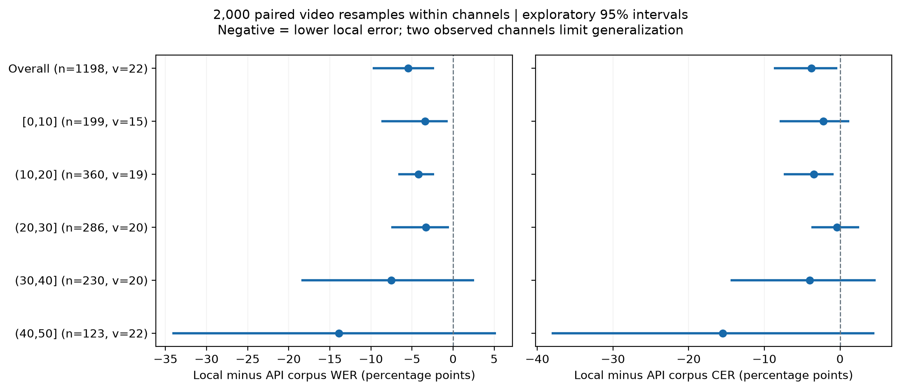

# Paired system uncertainty — November 19, 2026

The November 19 analysis is complete. Saved outputs only; no model loading, audio submission, credential access or paid API call.

## Frozen method and sign

Differences are **local minus API**, in percentage points. Negative means lower local error. Corpus scores sum edit counts and reference units before division; no mean-utterance substitute is used. WER is primary, CER secondary.

The frozen protocol uses 2,000 source-video bootstrap draws, seed 42, with videos sampled with replacement separately within each channel. Each draw contains three Channel A video selections and nineteen Channel B selections; it may contain repeated videos and a varying number of clips. All clips belonging to a selected video receive the same multiplicity in both systems. The 2.5th/97.5th percentiles of the paired corpus differences form exploratory intervals.

The same full-pool video draws are reused for bands/subsets, applying the group filter after assigning video multiplicities; videos with no group observations contribute zero. This preserves paired sampling and channel strata rather than independently redrawing each condition. There is no clip-level bootstrap, channel resampling, p-value, confirmatory significance decision or causal hosting claim.

Groups with fewer than ten represented videos have no interval, following the frozen rule. A zero-denominator draw would withhold the interval rather than silently redrawing or dropping that draw. All reported interval groups have 2,000 valid draws.

## Full pool and fixed CMI bands

| Group | Clips | Videos | WER difference (pp) | 95% interval | CER difference (pp) | 95% interval |
|---|---:|---:|---:|---|---:|---|
| Overall | 1198 | 22 | -5.46 | [-9.79, -2.31] | -3.79 | [-8.74, -0.38] |
| [0,10] | 199 | 15 | -3.39 | [-8.74, -0.63] | -2.22 | [-7.96, +1.24] |
| (10,20] | 360 | 19 | -4.23 | [-6.66, -2.28] | -3.47 | [-7.42, -0.83] |
| (20,30] | 286 | 20 | -3.31 | [-7.55, -0.48] | -0.41 | [-3.78, +2.52] |
| (30,40] | 230 | 20 | -7.50 | [-18.44, +2.57] | -4.00 | [-14.46, +4.70] |
| (40,50] | 123 | 22 | -13.87 | [-34.18, +5.24] | -15.52 | [-38.10, +4.57] |

The overall local-minus-API WER difference is -5.46 pp, with interval [-9.79, -2.31]. CER is -3.79 pp, with interval [-8.74, -0.38]. Both overall intervals lie below zero under this conditional resampling design. That supports the observed local advantage on this fixed pool; it is not a claim about every speaker, future provider run or deployment.

The three lower-CMI WER intervals lie below zero, while both higher-CMI WER intervals include zero. Their larger observed local advantages are accompanied by wider uncertainty. Separate band intervals do not establish different degradation slopes or equivalence in bands whose intervals span zero.



These intervals describe source-video resampling conditional on the two observed channels and fixed silver labels. They do not quantify provider rerun variability, annotation uncertainty or generalization to independent Nepali speakers/channels. Band intervals are separate exploratory summaries, not simultaneous intervals or a formal test that degradation slopes differ.

## Paired clip descriptions

| Metric | Local lower error | Tie | API lower error | Median paired difference (pp) | Mean paired difference (pp) |
|---|---:|---:|---:|---:|---:|
| WER | 488 | 372 | 338 | +0.00 | -10.08 |
| CER | 580 | 139 | 479 | +0.00 | -10.04 |

Each clip has the same reference denominator for both systems. Ties are exact equal edit counts. These clip summaries weight clips equally and are distinct from the reference-length-weighted corpus gap; no independence-based test is applied.

## Channel and duration context

| Group | Clips | Videos | WER difference (pp) | 95% interval | CER difference (pp) | 95% interval |
|---|---:|---:|---:|---|---:|---|
| Channel A | 608 | 3 | -6.00 | Withheld | -5.32 | Withheld |
| Channel B | 590 | 19 | -4.99 | [-11.19, +0.39] | -2.60 | [-9.17, +2.48] |

Channel A has three videos, so its interval is withheld even though it contributes 608 clips. Channel B has nineteen. Channels represent source IDs, not verified individual speakers. Duration-group differences below are descriptive only; cutpoints are 8.608, 9.872 and 11.552 seconds, with ties in the lower group.

| Duration group | Clips | Videos | Local-minus-API WER (pp) | CER (pp) |
|---|---:|---:|---:|---:|
| Q1 | 306 | 21 | -7.05 | -5.07 |
| Q2 | 295 | 20 | -7.01 | -5.14 |
| Q3 | 298 | 20 | -7.84 | -9.15 |
| Q4 | 299 | 21 | -1.96 | +1.55 |

## Video influence and source removal

Leave-one-video-out is an additional descriptive influence diagnostic, not a confidence interval, exclusion rule or replacement benchmark. Every planned clip remains in the headline result.

| Removed source video | Clips removed | WER difference after removal (pp) | CER difference after removal (pp) | WER change from full (pp) |
|---|---:|---:|---:|---:|
| -3PhO-CA2iw | 8 | -5.51 | -3.80 | -0.05 |
| 9SSyraZ2F2w | 160 | -4.38 | -2.61 | +1.08 |
| 9t3HtETn0JA | 46 | -5.77 | -4.17 | -0.31 |
| BbGvIkTR0ME | 15 | -5.50 | -3.81 | -0.04 |
| HQJoP3X6UdY | 34 | -5.89 | -4.19 | -0.43 |
| HUfMJuhOj5w | 72 | -4.40 | -2.58 | +1.06 |
| IPiEm1_ZaU4 | 51 | -5.24 | -3.82 | +0.22 |
| LhDdCCqBt4A | 40 | -5.20 | -3.63 | +0.26 |
| Mnm3U3UlPPU | 22 | -5.14 | -3.66 | +0.32 |
| P9dy-ECijcI | 279 | -6.28 | -4.89 | -0.81 |
| TftKf_L-qBA | 20 | -5.45 | -3.77 | +0.01 |
| bZFcrpg-tlo | 26 | -5.26 | -3.70 | +0.20 |
| d_ti-m5_s3s | 22 | -5.63 | -3.92 | -0.17 |
| eygbRVIhiJw | 1 | -5.47 | -3.79 | -0.01 |
| fT_Ued7BDDo | 44 | -5.77 | -4.46 | -0.30 |
| gtFNwgkYeXE | 10 | -5.59 | -3.92 | -0.13 |
| hDWNurAsWSE | 25 | -5.48 | -3.60 | -0.02 |
| qNsZlWl3yss | 30 | -6.18 | -4.26 | -0.72 |
| sGhq22Tx5ew | 169 | -5.56 | -3.25 | -0.10 |
| tfaFVT7CFiE | 1 | -5.47 | -3.79 | -0.01 |
| yTZL86j1yRE | 68 | -5.70 | -4.27 | -0.24 |
| zYLanqYoX24 | 55 | -5.38 | -3.55 | +0.08 |

Remaining-corpus differences after removing each whole channel:

- Remove Channel A: WER -4.99 pp; CER -2.60 pp.
- Remove Channel B: WER -6.00 pp; CER -5.32 pp.

Across all 22 single-video removals, WER gaps range -6.28 to -4.38 pp; CER gaps range -4.89 to -2.58 pp. This tests sensitivity to one observed video, not unmeasured confounding or unseen channels.

No single-video removal reverses the observed overall local advantage, and the point-estimate direction is also retained after removing either entire channel. This does not rule out joint influence of several videos or weak generalization to unseen sources. The longest duration quartile favors the API slightly on CER even though local has lower overall CER; the advantage is not universal across every descriptive group.

## Same-50 reference and lexical-CMI sensitivity

| Group | Clips | Videos | WER difference (pp) | 95% interval | CER difference (pp) | 95% interval |
|---|---:|---:|---:|---|---:|---|
| published | 50 | 18 | +6.16 | [-9.23, +24.77] | -4.34 | [-17.48, +8.04] |
| corrected | 50 | 18 | +6.23 | [-9.21, +24.75] | -4.37 | [-17.26, +7.87] |

Each condition uses the same 50 fixed hypotheses; published versus corrected references/CMI are separate. Eighteen represented videos permit an overall exploratory interval, but every audit band has fewer than ten videos and its interval is withheld. JSON records all audit-band points, counts and reasons. These balanced single-reviewer results are not population representative and cannot replace the full pool.

The audit-subset WER point estimate favors the API, but both reference-version intervals span zero widely. This subset does not establish a dependable opposite ranking; reference corrections leave the broad uncertainty and point direction largely unchanged.

## Interpretation and remaining work

The previously measured CMI–WER associations remain descriptive and near zero; this bootstrap targets corpus system differences, not Spearman uncertainty or a causal CMI effect. Channel/duration/influence checks can identify sensitivity, but cannot establish why recognition or script errors occurred. Listening to the ten preselected examples remains necessary before assigning speech-level error categories.

The configured systems differ in decoding/runtime and unknown provider internals. Silver-label and script-derived CMI uncertainty remain outside these intervals. Source-video clustering is an improvement over treating all clips as independent, but two channels are still a major limitation.

Next scheduled work: incorporate this analysis into the research-report draft on November 20; complete bounded listening examples November 21; reproduction/release checks November 22–24. The original November 16 PDF remains a dated v0.1 draft until revised.

## Reproduction and provenance

```powershell
.\.venv\Scripts\python.exe src/analyze_uncertainty.py
```

Install the existing `requirements-analysis.txt` in the project environment. JSON output: `results/metrics/paired_uncertainty_20261119.json`; figure PNG/SVG: `results/figures/paired_uncertainty_20261119.*`. JSON includes ordered video IDs, every draw multiplicity, source hashes, package versions, paired corpus points/intervals, audit bands and all 22 influence checks. All frozen inputs/predictions remain unchanged. The protocol/config are read and hash-validated before analysis; the overall totals are checked against both independent verifications.
