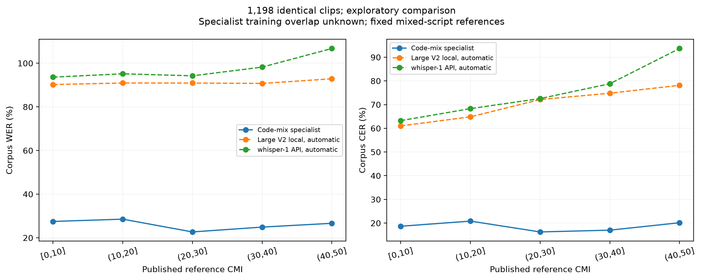
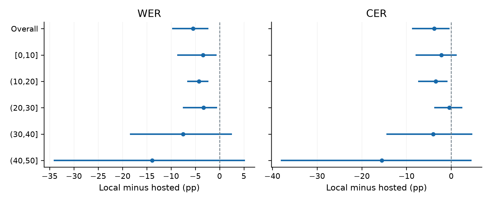

<!-- cover -->

# Code Mixing and Transcription Errors in Nepali English Speech

## A paired evaluation of general and specialized Whisper systems

**Sanskar Ananta Tiwari**

Independent research project

Research report | Revised working report v0.6 | November 27, 2026

How do general and specialized speech-recognition systems handle Nepali-English mixtures? This report compares three configured Whisper systems on identical audio, with separate evidence about references, uncertainty and training exposure.

| Audio clips | Systems compared | Audio duration |
|---|---|---|
| **1,198** | **3** | **199 minutes** |

Not peer reviewed. Original benchmark plus exploratory specialist extension. The specialist has much lower measured error, but its exclusion from training has not been independently verified. The previous report is preserved.

<!-- pagebreak -->

## Contents

For a quick overview, start with the plain-language summary, then the conclusion. The main text presents the research; appendices contain version identifiers, reproduction details and a glossary. Page numbers below refer to the PDF's physical pages, including the cover. Entries are clickable.

<!-- contents -->

<!-- pagebreak -->

## Plain-language summary

### What we wanted to find out

Does speech recognition make more errors as Nepali and English become more evenly mixed? We used the Code-Mixing Index (CMI), which measures that balance, and compared general and specialized Whisper systems.

### What we did

We transcribed the same 1,198 audio clips, about 199 minutes, and scored agreement with the dataset's written answer key. The original local Large V2 and hosted whisper-1 share a Large V2 foundation. A later extension tested a released Large V3 Turbo specialized for Nepali-English mixtures. We trained no models.

| System | Word error rate | Character error rate |
|---|---:|---:|
| Local Whisper Large V2 | 90.95% | 69.60% |
| Hosted Whisper API | 96.41% | 73.39% |
| Code-mix-specialized Large V3 Turbo | 25.94% | 18.42% |

### What changed and what did not

**The specialist made far fewer measured edits.** Its WER was 65.01 percentage points below the original local system and 70.47 below the API. The advantage appeared across all five CMI groups and remained large under source-video resampling.

**More balanced mixing did not show a steady rise in word errors.** All three CMI-WER correlations were near zero. Character-error patterns differed between systems and source channels. A weak correlation does not prove that mixing never matters.

### What the scores mean

Lower is better. WER counts changed, missing and added words against written references; extra words can push it above 100%. Script, spelling, word boundaries and number writing affect agreement. It is not a measure of meaning understood. A separate ten-clip review accepted some same-word variants for the original systems; no such allowances were added for the specialist.

### What remains uncertain

The specialist was trained partly on our source dataset. Our test selection is separate from that revision's training/validation splits, and 411 clips have matching text/duration candidates in the authors' public test outputs. Its actual training exclusion remains unverified. We therefore report a strong exploratory result on these clips, not proven unseen-speech superiority or a fine-tuning-only effect. Two source channels, mainly silver labels and one reviewer limit the wider conclusions.

<!-- pagebreak -->

## Abstract

This study examines the association between reference code-mixing intensity and Nepali-English ASR errors across three configured Whisper systems. The fixed dataset test selection contains 1,198 code-switched clips, 199.01 minutes, 22 videos and two source channels. The original paired benchmark compares local Large V2 through faster-whisper/CUDA FP16 with hosted whisper-1 using automatic language handling. A post-hoc extension evaluates an externally fine-tuned code-mix-specialized Large V3 Turbo, converted to CTranslate2 FP16, with Nepali specified and greedy decoding. On unchanged mixed-script silver references, normalized WER/CER are 90.95%/69.60% local, 96.41%/73.39% hosted and 25.94%/18.42% specialist. Specialist-minus-local WER is -65.01 percentage points with exploratory paired video-bootstrap interval [-68.77, -59.76]; specialist-minus-hosted is -70.47 points [-73.31, -67.05]. The original local-minus-hosted gap is -5.46 points [-9.79, -2.31]. Utterance CMI-WER correlations remain near zero: 0.0093 local, 0.0109 hosted and -0.0277 specialist. CMI-CER correlations are 0.2698, 0.2514 and 0.0066. The same 50-clip reference audit gives specialist WER 30.49% on published and 29.52% on corrected references; it is not a representative gold test. A separate ten-clip reviewed-variant analysis applies only to the original systems. Forced-Nepali sensitivity on those systems does not reproduce the specialist's gain. The specialist's training exclusion is unresolved despite supporting public held-out evidence. These results establish large observed differences in transcript agreement on this pool, not causal effects of hosting, fine-tuning or mixing, or verified generalization beyond the source and training conditions.

## 1 Research question and contribution

The primary question is whether more balanced Nepali-English word use is associated with more transcription errors under a fixed mixed-script convention. Secondary questions concern differences between the original local/hosted systems and the observed behavior of a released code-mix-specialized checkpoint. We distinguish a frozen original benchmark from later exploratory model and language-setting extensions. The project evaluates existing systems without training, translation or application development.

The contribution is a reproducible evaluation with unchanged audio/references, saved responses, source-video uncertainty, a bounded human audit and an explicit training-overlap investigation. The specialist was developed by other researchers; its inclusion is an additional evaluation, not our fine-tuning contribution. No first-study, state-of-the-art, semantic-accuracy or peer-reviewed-publication claim is made. A weak association and a large configured-system difference answer different questions and are both reported.

<!-- pagebreak -->

## 2 Background and related work

Whisper studies multilingual speech recognition using large-scale weak supervision [1]. Its multilingual scope motivates evaluation on mixed Nepali-English speech, but multilingual training alone does not establish performance on this dataset or its transcription convention.

Das and Gamback introduce a token-based code-mixing index in work on word-level language identification [2]. Gamback and Das subsequently investigate corpus-level comparisons of code-switching [3]. The present study uses a bilingual token-balance CMI, rather than treating it as a count of language alternations. It does not use the later corpus-level measure as an interchangeable definition.

Transcription conventions are particularly relevant when languages use different scripts. Emond and colleagues discuss evaluation distortions from rendering variation and propose transliteration-optimized WER [4]. PolyWER similarly studies evaluation that accepts alternative cross-script renderings [5]. These studies motivate caution in interpreting mixed-script WER. This benchmark retains its frozen primary WER/CER definitions. Its separate post-hoc sensitivity allows only manually approved, clip-specific single-token alternatives; it is not an implementation of either published framework and does not translate hypotheses.

This report therefore separates three issues: observed recognition-system output, agreement with a particular reference spelling/script convention, and the reliability of the reference and CMI labels. The measured error rates combine these issues. Completed listening records and variant sensitivity illustrate the distinction on ten examples, but do not quantify each issue's corpus-wide contribution.

Neupane and colleagues adapt models for Nepali-English code-mixed recognition and compare transcript conventions, numeric verbalization and model families [9]. Their released Whisper checkpoint [10] is the specialist evaluated here. Their results motivate the extension but use their own prepared test set and conventions; reported WER cannot be compared directly with our scores. Their paper says the original split assignments were retained and Whisper used the same training split, while warning that speaker-disjointness is not guaranteed. Section 5.10 distinguishes those statements from independently verifying training exclusion for our exact clips.

<!-- pagebreak -->

## 3 Dataset and evaluation population

The source is Sailesh Dahal's Nepali-English Code-Switched ASR dataset [6], default configuration, using a fixed, recorded dataset version. The exact revision identifier is in Appendix A. The pinned card describes educational STEM/CS speech from public YouTube videos, mixed-script canonical transcripts, channel-disjoint splits and predominantly silver labels: automatically produced transcripts that have not all been independently checked by people. The benchmark uses published `transcription`, not the fully Devanagari or fully romanized derivatives. Current dataset revisions must not silently replace this pinned revision.

| Population property | Value |
|---|---:|
| Published test rows in the default configuration | 1,765 |
| Candidates with stored speech_type equal to cs | 1,201 |
| Excluded before inference for missing source provenance | 3 |
| Frozen eligible paired clips | 1,198 |
| Audio duration | 11,940.723 seconds / 199.01205 minutes |
| Source videos / source channels | 22 / 2 |
| Normalized reference words / characters | 28,216 / 111,262 |

No clip was removed because of its transcription score. The field `speaker_id` identifies a YouTube channel, not a verified individual speaker. The test set is narrow in domain and source coverage. Channel-disjoint dataset partitions do not establish that the pretrained models never encountered related public audio.

## 4 Experimental methods

### 4.1 Frozen paired systems

The original two-system inputs, references and protocol were frozen before inference, completed November 14 locally and November 16, 2026 remotely. Both systems received identical ordered WAVs without reference hints. The specialist is a separate exploratory extension evaluated November 27 after inspection of the original results; its configuration was pinned before its new inference. All three use the same complete test selection.

| Setting | Local system | Hosted system |
|---|---|---|
| Model identifier | Systran/faster-whisper-large-v2 | OpenAI whisper-1 |
| Execution | faster-whisper / CTranslate2 | Audio transcription endpoint |
| Language handling | Automatic detection | Language parameter omitted |
| Decoding exposed to researcher | Beam 5, temperature 0 | Temperature 0, verbose_json |
| Context and prompting | No prior-text conditioning or prompt | No prompt |
| Precision and execution | CUDA FP16, batch 1 | Provider managed |
| Automatic retries | None | SDK retries 0 |

SYSTRAN documents the local implementation [7]. OpenAI describes whisper-1 as powered by Whisper V2 and documents temperature fallback [8]. The original two systems therefore share a Large V2 foundation, rather than representing independent model families. Hosted internals are not fully exposed; their observed gap does not isolate hosting location.

The local machine has an i7-11800H, approximately 16 GB RAM and an RTX 3060 Laptop GPU with 6,144 MiB memory. The protocol/manifest record model revision, weight checksum and software pins. A checkpoint-write interruption was recovered with responses preserved; independent verification required no repeated inference.

The third system is AI Lab Pvt. Ltd.'s released Nepali-English code-mix-specialized Large V3 Turbo [10]. Its public BF16 safetensors were checksum-verified and converted to CTranslate2 FP16. It runs locally with faster-whisper 1.2.1, batch one, beam one/best-of one, temperature zero, Nepali specified, no VAD and no transcript prompt or previous-clip context. Input processing uses the checkpoint's 128-mel configuration. Twenty existing validation clips checked the runtime; all 1,198 test clips were then retained regardless of score. No training was performed.

This is three systems with five measured configurations when the original systems' later forced-Nepali runs are included. The primary summary shows original automatic baselines and the specialist's intended Nepali setting; Section 5.9 provides the language-setting sensitivity. Different backbones, training histories, beam settings and implementations prevent attributing the full specialist advantage solely to fine-tuning. The original unfine-tuned Large V3 Turbo was not rerun, and conversion parity with the authors' Transformers implementation was not established. Exact versions are in Appendix A.

### 4.2 Scoring

WER counts words that are changed, missing or added compared with the reference transcript. Primary corpus WER sums these substitutions, deletions and insertions over all reference words in the evaluation set. Secondary CER uses character edits. These overall totals give longer references more weight; they are not averages of individual clip percentages. Insertions allow WER above 100%.

Normalization applies Unicode NFC, lowercasing, Devanagari-to-ASCII digits, punctuation-to-space conversion and whitespace collapse. CER excludes spaces and counts code points, not grapheme clusters. No translation or wholesale script conversion is applied. Raw case/punctuation-sensitive scores are retained.

### 4.3 CMI and analysis

For the human lexical audit, CMI = 100 x min(N_ne, N_en) / (N_ne + N_en), excluding language-independent tokens. Eight Nepali and two English tokens give CMI 20; five of each give 50. Zero indicates a single assigned language. CMI measures balance, not switch frequency or necessarily English dominance.

The full benchmark uses the source's published script-derived CMI. Five fixed bands are [0,10], (10,20], (20,30], (30,40], (40,50]. Descriptive Spearman correlations relate CMI to utterance error rates and paired local-minus-hosted WER. Positive paired differences mean more local error. Channel, video and duration summaries check composition; no causal adjustment or significance test is claimed.

## 5 Results

### 5.1 Coverage and overall errors

All three primary systems have 1,198 successful saved responses and complete paired coverage. The hosted run used 1,198 attempts and distinct request IDs, with no unresolved requests. Eleven local and one hosted responses are empty successful hypotheses; their deletion errors remain in the scores.

| System | Word edits | Corpus WER | Character edits | Corpus CER |
|---|---:|---:|---:|---:|
| Local Large V2 | 25,663 | 90.95% | 77,443 | 69.60% |
| Hosted whisper-1 | 27,204 | 96.41% | 81,657 | 73.39% |
| Code-mix specialist | 7,319 | 25.94% | 20,494 | 18.42% |

The original local-minus-hosted gaps are -5.46 percentage points WER and -3.79 points CER. Specialist-minus-local gaps are -65.01 WER / -51.18 CER points; specialist-minus-hosted gaps are -70.47 / -54.97. Each difference explicitly names its direction; negative means the first-named system has lower error. These are error rates, not accuracy percentages. Raw WER/CER are 93.75%/71.61% local, 98.76%/75.37% hosted and 32.05%/20.67% specialist. The large specialist advantage is an observed configured-system result, not verified generalization or an isolated training effect.

### 5.2 Fixed CMI bands

| CMI band | Clips | Videos | Words | Local WER | API WER | Local CER | API CER |
|---|---:|---:|---:|---:|---:|---:|---:|
| [0,10] | 199 | 15 | 4,478 | 90.22% | 93.61% | 61.03% | 63.24% |
| (10,20] | 360 | 19 | 7,975 | 90.92% | 95.15% | 64.85% | 68.32% |
| (20,30] | 286 | 20 | 7,217 | 90.91% | 94.22% | 72.14% | 72.55% |
| (30,40] | 230 | 20 | 5,843 | 90.72% | 98.22% | 74.82% | 78.82% |
| (40,50] | 123 | 22 | 2,703 | 92.86% | 106.73% | 78.16% | 93.68% |

The original baseline band table above remains unchanged. The specialist, on the same groups, gives:

| CMI band | Clips | Specialist WER | Specialist CER |
|---|---:|---:|---:|
| [0,10] | 199 | 27.49% | 18.67% |
| (10,20] | 360 | 28.54% | 20.83% |
| (20,30] | 286 | 22.68% | 16.27% |
| (30,40] | 230 | 24.90% | 17.02% |
| (40,50] | 123 | 26.64% | 20.15% |

Figure 1. Three-system corpus errors against unchanged published silver references. Points connect ordered bands for readability; no intervals are shown. Specialist WER ranges from 22.68% to 28.54%, without a steady rise. Its advantage is present in every band. The original local WER is mostly flat, hosted WER is nonmonotonic, and baseline CER rises across bands. Different model training exposure remains an unresolved limitation.

### 5.3 Paired video uncertainty

To check how sensitive the comparison is to the source videos, the analysis repeatedly resamples whole videos while keeping both systems paired. The frozen protocol specifies 2,000 video resamples, seed 42. Videos are sampled with replacement within each channel: three video selections from Channel A and nineteen from Channel B per draw. All paired clips of a selected video receive the same multiplicity in both systems. Corpus edit counts and reference units are summed before division. The 2.5th/97.5th percentiles of paired local-minus-hosted gaps form exploratory 95% intervals. The same full-pool draws are reused for bands and subsets, filtering after multiplicities are assigned; videos with no group observations contribute zero. Groups below ten represented videos have no interval. All reported intervals use 2,000 valid draws.

| Group | Clips | Videos | WER gap (pp) | 95% interval | CER gap (pp) | 95% interval |
|---|---:|---:|---:|---|---:|---|
| Overall | 1198 | 22 | -5.46 | [-9.79, -2.31] | -3.79 | [-8.74, -0.38] |
| [0,10] | 199 | 15 | -3.39 | [-8.74, -0.63] | -2.22 | [-7.96, +1.24] |
| (10,20] | 360 | 19 | -4.23 | [-6.66, -2.28] | -3.47 | [-7.42, -0.83] |
| (20,30] | 286 | 20 | -3.31 | [-7.55, -0.48] | -0.41 | [-3.78, +2.52] |
| (30,40] | 230 | 20 | -7.50 | [-18.44, +2.57] | -4.00 | [-14.46, +4.70] |
| (40,50] | 123 | 22 | -13.87 | [-34.18, +5.24] | -15.52 | [-38.10, +4.57] |

Figure 2. Paired corpus gaps in percentage points. Negative values favor local; dashed lines mark zero. The higher-CMI bands have wider uncertainty despite larger point gaps.

Both original local-minus-hosted overall intervals lie below zero under this conditional design. The two highest-CMI WER intervals span both directions; they neither establish different degradation slopes nor demonstrate equivalence. Intervals are separate exploratory summaries, not simultaneous bounds or confirmatory significance tests. They condition on two observed channels and fixed silver labels, excluding annotation uncertainty, unseen-channel variation and provider rerun variability.

**Specialist comparison under the same source-video design.**

The extension uses the same 2,000 channel-stratified video draws, seed and reference denominators. All specialist/baseline outcomes for a sampled video stay paired. These intervals describe observed-source uncertainty, not uncertainty about training exposure.

| Comparison | WER change (pp) | 95% interval | CER change (pp) | 95% interval |
|---|---:|---|---:|---|
| Specialist minus local | -65.01 | [-68.77, -59.76] | -51.18 | [-54.42, -46.93] |
| Specialist minus hosted | -70.47 | [-73.31, -67.05] | -54.97 | [-58.33, -51.78] |

Both specialist WER intervals lie well below zero. Relative to the original local system, the specialist has lower word-edit counts on 1,120 clips, ties on 21 and higher counts on 57; versus the original API, the corresponding counts are 1,134, 14 and 50. The advantage is not present in every clip. These results support a large measured difference within this pool while leaving unseen-data and fine-tuning-effect claims unresolved.

<!-- pagebreak -->

### 5.4 Continuous associations and source composition

| Utterance-level association | Spearman rho |
|---|---:|
| CMI versus local WER | +0.0093 |
| CMI versus hosted WER | +0.0109 |
| CMI versus local-minus-hosted WER | -0.0204 |
| CMI versus local CER | +0.2698 |
| CMI versus hosted CER | +0.2514 |
| CMI versus specialist WER | -0.0277 |
| CMI versus specialist CER | +0.0066 |
| CMI versus duration | +0.0236 |
| CMI versus normalized reference-word count | +0.0533 |

The original predeclared word-error associations are near zero, as is the later specialist association. The specialist CER association is also near zero, so the positive pooled baseline CER pattern does not extend to all evaluated systems. This does not rule out nonlinear relationships, subgroup patterns or effects hidden by noisy measurement. A higher final-band corpus rate is compatible with near-zero utterance rank correlation: corpus rates weight by reference length, while rank correlation describes ordering across individual clips.

| Source summary | Channel A | Channel B |
|---|---:|---:|
| Clips / videos | 608 / 3 | 590 / 19 |
| Mean published CMI | 16.85 | 29.50 |
| Local WER / hosted WER | 89.09% / 95.09% | 92.59% / 97.58% |
| CMI-local WER rho | -0.0169 | -0.0535 |
| CMI-hosted WER rho | -0.0080 | -0.0503 |
| CMI-local CER rho | +0.2891 | +0.0452 |
| CMI-hosted CER rho | +0.3048 | +0.0145 |

The specialist WER/CER are 29.70%/22.46% in Channel A and 22.64%/15.28% in Channel B. Its lower overall rates do not remove channel variation. The exact source-channel identifiers are recorded in Appendix A. The positive pooled CER associations are not uniform across sources. Channel A retains a clearer positive CER pattern, while Channel B's CER correlations are near zero. Both source composition and within-source differences matter to interpretation.

Duration has little pooled association with CMI. Duration-WER correlations are -0.0935 local and -0.1246 hosted. Descriptive duration quartiles use cutpoints 8.608, 9.872 and 11.552 seconds, with tied observations in the lower group. Shortest-quartile WER is 93.88% local / 100.93% hosted, compared with 90.19% / 92.15% in the longest quartile. These summaries are contextual checks, not adjustment for duration, source, speaker or audio quality.

Descriptive removal of each video in turn leaves WER gaps between -6.28 and -4.38 pp, and CER gaps between -4.89 and -2.58 pp. Neither single-video removal nor removal of either whole channel reverses the overall point direction. Channel A has only three videos, so its interval is withheld; Channel B's WER interval is [-11.19, +0.39] pp. These influence checks do not exclude joint effects of several videos or unseen-source differences. Local has lower WER on 488 clips, ties on 372 and higher WER on 338; clip counts do not substitute for corpus weighting.

### 5.5 Human reference and lexical CMI sensitivity

A frozen diagnostic subset contains 50 clips, ten per published CMI band, spanning 18 videos and both channels. One researcher listened to each selected clip, checked script-suggested language tags and saved the reference/tag decisions before held-out prediction inspection. The assistant checked validation and arithmetic, without independently listening. No inter-annotator agreement is available.

Forty-two references were retained and eight corrected. Comparing published text to the human version gives 18 normalized word edits over 979 human-reference words, or 1.84% reference-disagreement WER. This measures disagreement in the selected subset, not the dataset-wide reference error rate. The published-reference denominator for these clips is 974 words.

| Same 50 saved hypotheses | Published WER | Corrected WER | Published CER | Corrected CER |
|---|---:|---:|---:|---:|
| Local Large V2 | 100.82% | 100.41% | 76.30% | 75.83% |
| Hosted whisper-1 | 94.66% | 94.18% | 80.63% | 80.19% |
| Code-mix specialist | 30.49% | 29.52% | 24.14% | 23.50% |

Local word edits change from 982 to 983; hosted word edits remain 922. The reference denominator increases from 974 to 979. Thus lower rates do not mean improved hypotheses or fewer edit operations. The original local/API ranking differs from the full pool, while the specialist has lower measured error in both reference versions. Specialist word edits are 297 / 974 on published references and 289 / 979 on corrected references. Its corrected-reference WER gap is -70.89 points versus local, interval [-90.62, -51.07], and -64.66 points versus hosted, interval [-82.82, -49.14]. This balanced subset is not population-representative and cannot replace the full benchmark or settle training exclusion.

Ten audited CMI values differ beyond a +/-0.005-point source-rounding allowance, and four clips change bands. Audited counts become 11, 8, 10, 13 and 8. CMI differences can reflect reference edits, tokenization, denominator conventions and language judgments. They must not be attributed exclusively to tag overrides.

Using published references/source CMI, subset CMI-WER rho is -0.0197 local and -0.1347 hosted. Using corrected references/lexical CMI, it is +0.0104 and -0.1669. Both definitions change together; this subset does not isolate either change or validate all remaining labels.

The subset's local-minus-hosted WER gap is +6.16 pp with published references, interval [-9.23, +24.77], and +6.23 pp with corrected references, interval [-9.21, +24.75]. Both intervals span zero widely; this does not establish a dependable opposite ranking. The overall subset has eighteen videos, but every audit band has fewer than ten and no band interval is reported.

### 5.6 Timing and usage

The summed completed original local transcription time is 45.57 minutes; summed hosted client request turnaround is 53.72 minutes. Specialist generation totals 9.19 minutes for 199.01 audio minutes, a real-time factor of 0.046. Its request-start timestamps span about 13.72 minutes before final saving/scoring, but this is not complete setup-to-report wall time. Its shorter decoder and beam-one configuration differ from the original beam-five Large V2 setup, so no matched-setting speedup is claimed. These scopes differ: local records materialized generation, while hosted includes network and service turnaround. Neither is complete workflow wall time; local excludes model loading and checkpoint recovery. No matched-hardware speed or total economic-cost claim follows.

The specialist ran entirely locally and used no paid API calls; its largest whole-device post-transcription memory snapshot was 3,587 MiB, not a continuously measured model peak. The original local largest snapshot was 5,200 MiB. Provider-reported original main-run usage is 12,549 audio seconds, or 209.15 minutes. The saved November 16 rate of USD 0.006 per minute gives an estimated USD 1.25490 usage charge. Invoice, taxes, balance and unrelated account usage were not verified. Largest observed whole-device GPU memory is 5,200 MiB; one snapshot is missing and continuous model peak/energy were not measured.

### 5.7 Listening-based diagnostic examples

This listening analysis concerns only the original two systems. The frozen protocol preselected ten clips, two per published CMI band, from the audited subset. They span nine videos. All ten now have saved researcher listening confirmations and qualitative judgments. This bounded set was not selected by highest observed error, but is too small and deliberately balanced to estimate corpus-wide error prevalence. The reviewer checked the published reference and classified each system's output; categories can overlap within a clip.

| Recorded category | Local clips | Hosted clips |
|---|---:|---:|
| Script or spelling difference | 6 | 5 |
| Missing speech | 3 | 2 |
| Wrong language output | 2 | 2 |
| Wrong word | 1 | 0 |
| Extra or repeated text | 1 | 1 |
| No clear error | 0 | 1 |
| Uncertain category | 0 | 0 |

These are counts of entered clip labels out of ten, not percentages of words or mutually exclusive error types. The researcher marked all ten published references as matching the audio in this review. That judgment does not establish gold-reference quality, and this later diagnostic step did not modify the frozen 50-clip audit or any primary reference.

Example 01's notes report that the English word "hard" is missing from both systems, with additional local omissions. Example 04 notes joined words, illustrating a boundary mismatch that exact whitespace-token WER can penalize. Example 06 records extra/repeated text in both systems and a local omission. Examples 03 and 08 were marked as wrong-language output for both systems. Example 05's hosted output was marked as having no clear error. These are the reviewer's recorded observations, not independently replicated listening findings.

The records are concise and have limitations. For example, Example 05's local label includes wrong word while its note mentions a missing word, and Example 07's hosted note mentions missing words without a missing-speech category. These inconsistencies were disclosed and preserved rather than silently relabeled. Absence of a category therefore cannot prove absence of that error. No inter-annotator agreement or exhaustive word-level error taxonomy is available. Different script alone is not evidence of a different spoken language; repeated output alone is not proof of hallucination.

A review-save issue was corrected from the researcher's original entries, without changing model responses or benchmark scores. Appendix A records the correction and its provenance.

### 5.8 Post-hoc reviewed spelling/transliteration sensitivity

The high original-system strict error rates and subsequent inspection motivated a separate analysis on the same ten clips, after the main results were known. No specialist word-variant allowances or new listening judgments were added; its new ten-example text comparison is a review aid only. This extension was not predeclared and does not change the primary benchmark. Both systems retain their saved hypotheses and the same 185 normalized published-reference words.

The original scoring algorithm first pairs reference words with model words, proposing single-word differences for review. These pairings minimize written word edits, so they are not always the words a listener would naturally pair. Identical reference/output pairs within a clip are reviewed once, with occurrences retained for both systems. The researcher listened and chose same, different, unsure or reference/alignment issue for all 159 distinct within-clip pairs. The researcher explicitly confirmed that same means the same audible lexical word written differently, not merely understandable meaning, a synonym, translation or an inflection change.

The original decisions contained 37 same-word allowances. A subsequent assistant text/context check conservatively withdrew six as unsure: possible inflection changes such as service versus serviced and task versus tasks, partial-token pairings, and a numeric token aligned with text apparently belonging elsewhere in the sentence. These exclusions do not assert a new audio judgment. Original judgments and timestamps remain in history, with assistant amendments separately attributed. Current decisions are 31 same, 47 different, 75 reference/alignment issue and 6 unsure.

For the approved-only score, a same pair has zero substitution cost within its clip, in either system where it occurs. Word edit distance is then recomputed. No global or transitive aliases, automatic phonetic threshold, translation or reference editing are used. Insertions and deletions retain unit cost. Uncertain and reference/alignment-issue pairs receive no allowance. Alternative alignment can change the edit reduction, so the number of accepted pairs is not itself the number of forgiven edits.

| System | Strict edits / words | Strict WER | Approved-only edits / words | Approved-only WER |
|---|---:|---:|---:|---:|
| Local Large V2 | 148 / 185 | 80.00% | 128 / 185 | 69.19% |
| Hosted whisper-1 | 192 / 185 | 103.78% | 166 / 185 | 89.73% |

The local reduction is 20 edit operations, or 10.81 percentage points; the hosted reduction is 26 edits, or 14.05 points. Under the original 37 allowances, rates were 67.57% local and 88.11% hosted; those historical snapshots are preserved. The conservative figures above are the current result. Forty independent shortest-path alignment checks reproduce the ten-clip strict and approved-only counts.

This demonstrates sensitivity of string-based scores to the accepted rendering choices on these examples. It does not reveal the percentage of genuinely wrong spoken words, validate semantic accuracy, or establish a corpus-wide proportion of spelling errors. The 75 combined reference/alignment labels do not establish 75 inaccurate dataset words. Strict candidate alignment can mispair words and miss valid split/joined-word alternatives; the remaining 31 approvals are single-reviewer judgments, not independently verified equivalences. Six exclusions remain unresolved, and no interval or representative population estimate is claimed for this post-hoc subset.

### 5.9 Language-setting sensitivity

Because the specialist uses Nepali specified while the original baselines used automatic handling, both original systems were also run with Nepali specified on all 1,198 clips. These follow-up outputs were saved separately and the automatic results were reused. This is a language-setting sensitivity, not a new provider or trained model.

| Original system | Automatic WER | Forced Nepali WER | Change (pp) | 95% interval |
|---|---:|---:|---:|---|
| Local Large V2 | 90.95% | 91.13% | +0.17 | [-0.97, +1.60] |
| Hosted whisper-1 | 96.41% | 97.12% | +0.71 | [-0.25, +2.05] |

Both overall WER intervals span zero. Forced-condition CER is 70.57% local and 75.35% hosted. The specialist remains lower by 65.19 WER points versus forced local, interval [-68.88, -59.91], and 71.18 points versus forced hosted, interval [-74.39, -67.75]. Specifying Nepali alone therefore does not reproduce the specialist's large observed advantage. It does not isolate fine-tuning: backbone, training exposure, beam and implementation still differ. Hosted settings were evaluated on different dates, so service variability is not separated from the language parameter. A forced language label is not measured detection accuracy.

### 5.10 Training exposure audit and interpretation

The specialist authors disclose 44.5 training hours from the same lecture dataset [9,10]. Our exact source revision places all 1,198 clips in its test split; none of their canonical clip identities, 22 source videos or two channels appears in that revision's train or validation split. This verifies our selection, not the checkpoint's actual training history.

The authors' public output table contains 1,574 lecture test records. Our audit finds the following conservative candidates, using exact project-normalized reference text plus duration within about one millisecond:

| Public test evidence | Our clips |
|---|---:|
| Unique normalized-text and duration candidate | 411 |
| No exact candidate | 787 |
| Ambiguous candidates | 0 |

The public IDs are aliases without original video/timestamp or waveform-hash links. Matching records support reported held-out use but do not independently verify audio identity or absence of duplicates in training. The 787 unmatched clips are not labelled as training examples: number verbalization, rewriting and filtering can prevent matches. The paper says inherited split assignments were preserved and Whisper used the same training split, but no membership list was found in the inspected official resources [9]. Shared-speaker warnings are not proof of reusing the same clip.

**Training exclusion remains unverified.** This report includes the specialist's fixed-pool scores as exploratory findings, without treating them as independently confirmed unseen-data evaluation. A definitive audit needs the actual training/validation identities or author confirmation against the prepared canonical identity packet, including overlapping or augmented recordings. No authors were contacted and no private data was accessed. The unresolved status is retained in the machine-readable audit rather than converted into an assumption of either leakage or cleanliness.

## 6 Discussion and limitations

The specialist produces a large reduction in measured edits across every CMI band and both channels. The same-50 reference sensitivity and conditional video intervals retain that observed advantage. This supports the practical relevance of configured-system choice on this pool. It does not separate recognition quality from script rendering, reference convention, training exposure, backbone or decoding. Training identities and a matched original Large V3 Turbo comparison are needed for stronger attribution.

Near-zero CMI-WER associations occur in all three systems. Baseline CMI-CER associations vary by channel, while the specialist association is near zero. A universal monotonic degradation slope is therefore unsupported. This does not prove that switches never cause errors: CMI measures balance, stored source labels are imperfect, and pooled summaries can hide nonlinear or subgroup effects.

Writing conventions remain part of the measurement. Names, borrowing, numbers, transliteration and word boundaries can change string agreement without an equivalent change in meaning [4,5,9]. The ten-clip sensitivity applies only to the original systems. No corpus-wide English-preservation score, semantic-accuracy metric or independently verified language-detection accuracy was measured.

Most references are silver, and the 50-clip single-reviewer audit is not representative gold truth. Educational speech from two channels and uneven video contributions restrict generalization. Conditional bootstrap intervals exclude annotation uncertainty, training contamination, unseen-channel variation and provider rerun variability. The specialist is a post-hoc extension with unresolved training exclusion; the original systems share a Large V2 foundation and differ in exposed/provider-managed settings. Neither a causal hosting effect nor a matched-setting speedup is established. Short diagnostic notes, category inconsistencies and one listener limit qualitative conclusions. Lower specialist WER was not converted into new listening judgments or tolerant allowances.

## 7 Conclusion

On the same 1,198 clips and references, the specialist has WER/CER 25.94%/18.42%, versus 90.95%/69.60% for original local Large V2 and 96.41%/73.39% for hosted whisper-1. Its WER advantages are 65.01 and 70.47 percentage points, with exploratory paired intervals below zero. This is a large observed configured-system difference; training exclusion is unverified, and fine-tuning, backbone and implementation effects are not isolated.

CMI-WER correlations remain near zero across all three systems. The study therefore does not confirm a steady word-error increase with more balanced mixing. Character-error patterns vary by system and source. The ten-clip variant analysis documents rendering sensitivity for the original systems, not semantic accuracy or corpus-wide error causes.

The contribution is a reproducible, source-bounded evaluation with explicit exploratory extensions. Training/validation exclusion and a matched unfine-tuned Large V3 Turbo comparison would strengthen interpretation. No peer-review, exhaustive-novelty or universal-superiority claim is made.

<!-- pagebreak -->

## References

[1] Alec Radford, Jong Wook Kim, Tao Xu, Greg Brockman, Christine McLeavey and Ilya Sutskever. 2023. Robust Speech Recognition via Large-Scale Weak Supervision. ICML, PMLR 202, 28492-28518. [Paper and proceedings](https://proceedings.mlr.press/v202/radford23a.html).

[2] Amitava Das and Bjorn Gamback. 2014. Identifying Languages at the Word Level in Code-Mixed Indian Social Media Text. ICON, 378-387. [ACL Anthology](https://aclanthology.org/W14-5152/).

[3] Bjorn Gamback and Amitava Das. 2016. Comparing the Level of Code-Switching in Corpora. LREC, 1850-1855. [ACL Anthology](https://aclanthology.org/L16-1292/).

[4] Jesse Emond, Bhuvana Ramabhadran, Brian Roark, Pedro Moreno and Min Ma. 2018. Transliteration based approaches to improve code-switched speech recognition performance. IEEE SLT, 448-455. [Authors' research page](https://research.google/pubs/transliteration-based-approaches-to-improve-code-switched-speech-recognition-performance/).

[5] Karima Kadaoui, Maryam Al Ali, Hawau Olamide Toyin, Ibrahim Mohammed and Hanan Aldarmaki. 2024. PolyWER: A Holistic Evaluation Framework for Code-Switched Speech Recognition. Findings of EMNLP, 6144-6153. [ACL Anthology](https://aclanthology.org/2024.findings-emnlp.356/).

[6] Sailesh Dahal. 2026. Nepali-English Code-Switched ASR. Hugging Face dataset, fixed revision recorded in Appendix A. [Pinned dataset card](https://huggingface.co/datasets/saileshbro/nepali-cs-asr/blob/dd00ca41dd38774cd6097c372c16939d7f3746df/README.md). Dataset card records CC BY-NC 4.0; source audio is not embedded in this report.

[7] SYSTRAN. faster-whisper. Software repository; evaluated package version 1.2.1. [Official repository](https://github.com/SYSTRAN/faster-whisper).

[8] OpenAI. Audio transcription API reference. Evaluated model whisper-1, described as powered by Whisper V2. [Official API reference](https://developers.openai.com/api/reference/python/resources/audio/subresources/transcriptions/methods/create). Service documentation may change; saved requests and responses define this experiment.

[9] Jeevan Neupane, Janardan Bhetwal, Kshitiz Paudel, Anup Aryal and Bipin Bashyal. 2026. Nepali-English Code-Mixed Speech Recognition: Data Preparation and Adaptation of a Speech Foundation Model. arXiv preprint, November 10, 2026. [Paper version 1](https://arxiv.org/html/2611.13512v1).

[10] AI Lab Pvt. Ltd., Nepal. 2026. Whisper Large V3 Turbo fine-tuned for Nepali-English code-mixed speech recognition. CC BY-NC 4.0 checkpoint. [Pinned model card](https://huggingface.co/ailabpvtltd/whisper-large-v3-turbo-nepali-english-codemix-asr/blob/8eff5c489628694a9f3ff2a02f3225ccfd6c6046/README.md).

<!-- pagebreak -->

## Appendix A Exact versions and review provenance

### A.1 Why this report records a long identifier

A revision selects the exact dataset version; a checksum verifies file identity. These identifiers support reproducibility and are not research scores or personal identifiers.

**Dataset:** saileshbro/nepali-cs-asr, default configuration.

**Exact dataset revision:** `dd00ca41dd38774cd6097c372c16939d7f3746df`

**Source-channel identifiers:** Channel A is `UChx9-bynjfm6Js3k54Sf1Mg`; Channel B is `UCy-Q66KQYSQAUVKvdNxgKbw`. These identify source YouTube channels, not verified individual speakers.

**Evaluation selection:** test split, stored speech_type equal to cs, with the pre-inference eligibility rules recorded in the frozen manifest. Published mixed-script transcription is the primary reference. The manifest stores the selected clip IDs, audio identities and checksums.

### A.2 Systems and frozen settings

The original system settings are in Section 4 and the frozen manifest/protocol: Large V2 automatic through faster-whisper, and whisper-1 with language omitted. Saved software pins and exposed options define the comparison; hosted internals remain provider-managed. Machine-readable records retain exact input, model and prediction hashes.

**Specialist checkpoint:** `ailabpvtltd/whisper-large-v3-turbo-nepali-english-codemix-asr`.

**Pinned specialist revision:** `8eff5c489628694a9f3ff2a02f3225ccfd6c6046`.

**Original weights SHA-256:** `4c0a8779438f23ac518d6e4379c0f6edfacb8a470320fceb43081f9936eef549`.

The separate CPU conversion environment used PyTorch 2.9.1, Transformers 4.57.6 and CTranslate2 4.8.5. Conversion/model hashes, package pins and source manifests are in `configs/codemix_turbo_experiment_20261127.json`. This does not identify the checkpoint's training members. The overlap audit pins the authors' repository and test-output dataset revisions separately.

### A.3 Review corrections and their limits

An Example 09 cell originally saved to Example 08. The researcher's unsaved literal entries were preserved and restored to the correct records on November 23, with history and recovery provenance retained. Neither model responses nor primary references changed. The assistant supplied no new listening judgments.

Six original same-word allowances were conservatively changed to unsure after assistant text review; original human decisions remain in history. The remaining 31 approvals are single-reviewer judgments. The follow-up record links annotation hashes to forty independent edit-distance checks. Hashes verify saved-file identity, not acoustic correctness.

<!-- pagebreak -->

## Appendix B Reproduction and release status

The repository is [SaTz010/Research-asr](https://github.com/SaTz010/Research-asr). Version 0.5 was published November 24; that dated PDF and its editable source are preserved. Version 0.6 is a local revision prepared November 27 and has not been pushed or posted to a website or LinkedIn by this revision workflow. The stable editable source is `reports/research_report_draft.md`, with a stable PDF download filename and a separate dated v0.6 PDF.

The original frozen inputs remain `data/manifests/test_cs_benchmark_20261112.json` and `configs/evaluation_protocol_20261112.json`. Original predictions, reference audits, qualitative decisions and word-variant histories are unchanged. Their earlier results retain the same scores, 2,000 source-video draws and denominators. Historical publication verification applies to v0.5, not automatically to this expanded revision.

The specialist run uses `configs/codemix_turbo_experiment_20261127.json` and saved predictions/metrics with prefix `test_codemix_turbo_20261127`. Its independent `_verified.json` receipt reconstructs raw hypotheses and all normalized/raw edit counts. `src/analyze_codemix_experiment.py` recreates the specialist comparisons and figure. Its `--saved-text-only` mode reuses saved responses without audio, weights, a GPU or API calls and checks against the original audio-verification receipt. The default mode additionally rechecks the cached WAV identities.

The forced-language extension is defined in `configs/forced_ne_protocol_20261124.json`, with separate manifests and predictions. `src/analyze_forced_nepali.py` reproduces its paired results without inference. The overlap audit is `results/metrics/codemix_training_overlap_audit_20261127.json`; the 1,198-identity request packet is `data/manifests/codemix_overlap_request_20261127.json`. The recorded public-test candidate evidence is not a training-membership certificate. Repeating the external evidence inspection requires its public source tables; saved-output replay does not contact authors or independently verify their private training history.

The original v0.5 fresh Windows/CPython 3.13 environment check passed 145 tests, four analysis JSON replays and PDF text/page-count comparison without audio or network connections. This revision extends the offline replay to include the specialist and forced-language results, checks their numerical agreement, and builds the revised PDF in an isolated copy. The current dated verification record gives its test count, stage outcomes and scope; it is not a rerun of model inference or a new independent listening audit. The original environment's lock and `src/reproduce_results.py` are used; REPRODUCING.md explains the commands. No inference runtime or model weights are needed for saved-output reproduction.

The PDF uses ReportLab, Windows Arial and included dated figure assets. The replay regenerates analysis figures, including the specialist comparison. Platform/font portability and binary-identical PDF timestamps are not established. Source audio/video, model weights, private caches and credentials remain excluded from publication files. For reviewed-variant replay without audio, use `src/variant_sensitivity.py --saved-text-only` in an isolated copy.

The researcher supplied the listening, reference and token-language judgments. An AI coding assistant supported implementation, source checks, arithmetic, drafting, formatting and the text-based conservative variant exclusions. It did not independently hear or validate the audio. The researcher should review the revised claims before public release. No outreach or new training was performed during report revision.

Original report text and figures are licensed [CC BY 4.0](https://creativecommons.org/licenses/by/4.0/) by Sanskar Ananta Tiwari. Dataset-derived transcript excerpts and third-party model outputs retain their separate source terms; the specialist checkpoint is CC BY-NC 4.0 and its weights are not distributed here. Original code is MIT-licensed. LICENSING.md and DATA_SOURCES.md describe the original grants and source attribution.

<!-- pagebreak -->

## Appendix C Glossary and how to read the scores

| Term | Meaning in this report |
|---|---|
| ASR | Automatic speech recognition: converting spoken audio into a written transcript. |
| Code switching | Using Nepali and English within the same speech sample. No translation is requested from the recognizer. |
| Reference transcript | The dataset's written answer key used for scoring. A reference can itself contain mistakes. |
| Hypothesis | The transcript produced by a speech-recognition system. It does not mean an untested research claim in a score table. |
| Local / hosted | Local runs on the researcher's device. Hosted sends audio to a provider's transcription service through an API, a software interface for making requests. |
| WER | Word error rate: changed, missing and added words divided by reference words. Lower is better; added words allow rates above 100%. |
| CER | Character error rate: written-character edits divided by reference characters. Here, spaces are excluded and Unicode code points are counted. |
| CMI | Code-Mixing Index: how evenly the language-bearing words are divided between the two languages. With two languages, 0 means one assigned language and 50 means equal counts. It does not count switch points. |
| Corpus rate | One error rate for the whole selected set, obtained by adding errors and reference units before division. |
| Silver labels | Mostly automatically produced transcripts or labels; they are not independently verified human ground truth for every clip. |
| Spearman rho | A measure of whether higher values of one variable tend to accompany higher or lower values of another. A value near zero means little monotonic rank association, not proof of no possible relationship. |
| Percentage point (pp) | A difference between two percentages: 96.41% minus 90.95% is about 5.46 percentage points. |
| Video-bootstrap interval | An exploratory range from repeatedly resampling source videos. It describes variation under the observed sampling design, not all possible sources of uncertainty. |
| Reviewed-variant WER | A separate ten-clip score accepting specified same-word renderings. It is not semantic accuracy or a replacement for the main benchmark. |
| Post-hoc analysis | An analysis added after seeing the main results, such as this specialist extension. It is identified explicitly because it was not part of the original frozen plan. |
| Code-mix specialist | An externally fine-tuned model targeting mixed Nepali-English transcripts. This project evaluated the released checkpoint without training it. |
| Training overlap | Exposure of evaluation audio, duplicate/overlapping recordings or derivatives during model training. Validation/checkpoint selection also affects independence. Shared speakers alone do not prove exact clip overlap. |
| Exploratory result | A measured result whose scope or design limits stronger confirmation. The specialist score is observed; its training exclusion remains unresolved. |
| Revision ID / checksum | A revision selects an exact dataset version. A checksum helps verify that saved files have not changed. Neither is an accuracy score. |

**Reading rule:** compare like with like. The full benchmark has 1,198 clips; the reference audit has 50; the reviewed-variant analysis has ten. Their scores have different denominators and purposes. A subset's score must not be presented as the result for the full dataset.
