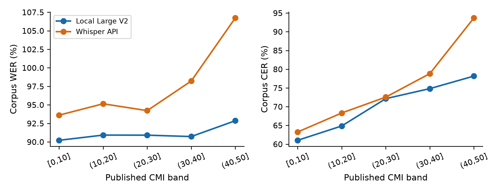
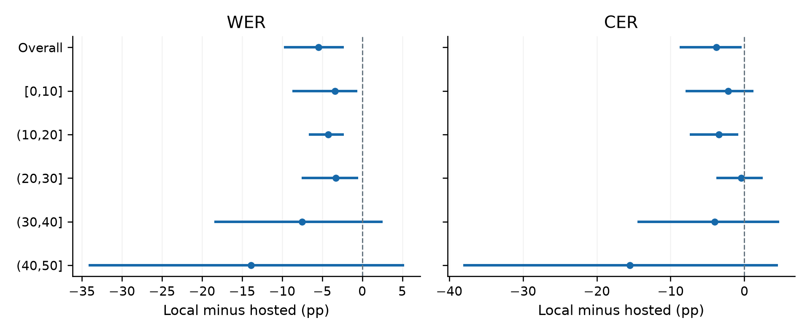

# Code Mixing and Transcription Errors in Nepali English Speech

## A paired evaluation of local and hosted Whisper

**Sanskar Ananta Tiwari** | Independent research project

Working draft v0.2 | November 19, 2026 | Not peer reviewed

**Status:** Inference, descriptive analyses and paired video-cluster uncertainty are complete. This revision completes the planned November 20 report work early. Listening-based error examples and final release verification remain unfinished. This is a review draft, not the final public release.

## Abstract

This study examines whether reference code-mixing intensity is associated with transcription errors in Nepali-English speech and whether two configured Whisper systems exhibit different patterns. A frozen evaluation set contains 1,198 code-switched test clips, totaling 199.01 minutes, from 22 videos and two source channels in the saileshbro/nepali-cs-asr dataset. Local Whisper Large V2 through faster-whisper with CUDA FP16 and hosted OpenAI whisper-1 transcribe identical audio with automatic language handling. Evaluation uses corpus word error rate (WER), character error rate (CER), five fixed Code-Mixing Index (CMI) bands and descriptive Spearman associations. Against published mixed-script silver references, local WER/CER are 90.95%/69.60%, compared with 96.41%/73.39% hosted. The local-minus-hosted WER gap is -5.46 percentage points, with an exploratory 95% paired video-bootstrap interval of [-9.79, -2.31]; the CER gap is -3.79 points, interval [-8.74, -0.38]. Clip-level CMI-WER associations are near zero (rho 0.0093 local, 0.0109 hosted). CMI-CER associations are positive (0.2698 and 0.2514) but vary substantially by channel. A single-reviewer 50-clip audit checks reference and lexical-CMI sensitivity. The observed overall local advantage persists under conditional video resampling, but high-CMI band comparisons remain imprecise. These findings do not identify causal effects of mixing or hosting and do not generalize beyond the two observed channels without further evidence.

## 1 Research question and contribution

The practical question is whether speech containing more balanced Nepali and English word use is harder for the evaluated recognizers to transcribe under a fixed mixed-script convention. The study also asks whether the observed pattern differs between a locally executed Whisper system and a hosted Whisper service. The target is an empirical comparison of existing systems, without new training, translation or application development.

The contribution is a reproducible paired benchmark on a pinned dataset revision, with explicit coverage, fixed settings, saved responses, source-aware analysis and a human-reviewed diagnostic subset. No claim of being the first Nepali-English ASR study, of improving a model, or of peer-reviewed publication is made. A weak or absent association is an informative outcome.

<!-- pagebreak -->

## 2 Background and related work

Whisper studies multilingual speech recognition using large-scale weak supervision [1]. Its multilingual scope motivates evaluation on mixed Nepali-English speech, but multilingual training alone does not establish performance on this dataset or its transcription convention.

Das and Gamback introduce a token-based code-mixing index in work on word-level language identification [2]. Gamback and Das subsequently investigate corpus-level comparisons of code-switching [3]. The present study uses a bilingual token-balance CMI, rather than treating it as a count of language alternations. It does not use the later corpus-level measure as an interchangeable definition.

Transcription conventions are particularly relevant when languages use different scripts. Emond and colleagues discuss evaluation distortions from rendering variation and propose transliteration-optimized WER [4]. PolyWER similarly studies evaluation that accepts alternative cross-script renderings [5]. These studies motivate caution in interpreting mixed-script WER. This benchmark retains its frozen WER/CER definitions; it does not implement either alternative metric or translate hypotheses to improve scores.

This report therefore separates three issues: observed recognition-system output, agreement with a particular reference spelling/script convention, and the reliability of the reference and CMI labels. The measured error rates combine these issues; a listening-based categorization has not yet quantified their individual contributions.

## 3 Dataset and evaluation population

The source is Sailesh Dahal's Nepali-English Code-Switched ASR dataset [6], default configuration, revision `dd00ca41dd38774cd6097c372c16939d7f3746df`. The pinned card describes educational STEM/CS speech from public YouTube videos, mixed-script canonical transcripts, channel-disjoint splits and predominantly silver labels. The benchmark uses published `transcription`, not the fully Devanagari or fully romanized derivatives. Current dataset revisions must not silently replace this pinned revision.

| Population property | Value |
|---|---:|
| Published test rows in the default configuration | 1,765 |
| Candidates with stored speech_type equal to cs | 1,201 |
| Excluded before inference for missing source provenance | 3 |
| Frozen eligible paired clips | 1,198 |
| Audio duration | 11,940.723 seconds / 199.01205 minutes |
| Source videos / source channels | 22 / 2 |
| Normalized reference words / characters | 28,216 / 111,262 |

No clip was removed because of its transcription score. The field `speaker_id` identifies a YouTube channel, not a verified individual speaker. The test set is narrow in domain and source coverage. Channel-disjoint dataset partitions do not establish that the pretrained models never encountered related public audio.

<!-- pagebreak -->

## 4 Experimental methods

### 4.1 Frozen paired systems

Inputs, references and protocol were frozen before held-out inference, completed November 14 locally and November 16, 2026 remotely. Both systems received identical ordered WAVs without reference hints.

| Setting | Local system | Hosted system |
|---|---|---|
| Model identifier | Systran/faster-whisper-large-v2 | OpenAI whisper-1 |
| Execution | faster-whisper / CTranslate2 | Audio transcription endpoint |
| Language handling | Automatic detection | Language parameter omitted |
| Decoding exposed to researcher | Beam 5, temperature 0 | Temperature 0, verbose_json |
| Context and prompting | No prior-text conditioning or prompt | No prompt |
| Precision and execution | CUDA FP16, batch 1 | Provider managed |
| Automatic retries | None | SDK retries 0 |

SYSTRAN documents the local implementation [7]. OpenAI describes whisper-1 as V2-based and documents temperature fallback [8]. Hosted weights, preprocessing and decoding are unavailable; this configured-system comparison cannot isolate a causal hosting effect.

The local machine has an i7-11800H, approximately 16 GB RAM and an RTX 3060 Laptop GPU with 6,144 MiB memory. The protocol/manifest record model revision, weight checksum and software pins. A checkpoint-write interruption was recovered with responses preserved; independent verification required no repeated inference.

### 4.2 Scoring

Primary corpus WER sums substitutions, deletions and insertions over total reference words. Secondary CER uses character edits. These corpus-weighted totals are not mean utterance rates. Insertions allow WER above 100%.

Normalization applies Unicode NFC, lowercasing, Devanagari-to-ASCII digits, punctuation-to-space conversion and whitespace collapse. CER excludes spaces and counts code points, not grapheme clusters. No translation or wholesale script conversion is applied. Raw case/punctuation-sensitive scores are retained.

### 4.3 CMI and analysis

For the human lexical audit, CMI = 100 x min(N_ne, N_en) / (N_ne + N_en), excluding language-independent tokens. Eight Nepali and two English tokens give CMI 20; five of each give 50. Zero indicates a single assigned language. CMI measures balance, not switch frequency or necessarily English dominance.

The full benchmark uses the source's published script-derived CMI. Five fixed bands are [0,10], (10,20], (20,30], (30,40], (40,50]. Descriptive Spearman correlations relate CMI to utterance error rates and paired local-minus-hosted WER. Positive paired differences mean more local error. Channel, video and duration summaries check composition; no causal adjustment or significance test is claimed.

<!-- pagebreak -->

## 5 Results

### 5.1 Coverage and overall errors

Both systems have 1,198 successful saved responses and complete paired coverage. The hosted run used 1,198 attempts and distinct request IDs, with no unresolved requests. Eleven local and one hosted responses are empty successful hypotheses; their deletion errors remain in the scores.

| System | Word edits | Corpus WER | Character edits | Corpus CER |
|---|---:|---:|---:|---:|
| Local Large V2 | 25,663 | 90.95% | 77,443 | 69.60% |
| Hosted whisper-1 | 27,204 | 96.41% | 81,657 | 73.39% |

The observed local-minus-hosted gaps are -5.46 percentage points WER and -3.79 points CER; negative values mean lower local error throughout this report. These are error rates, not accuracy percentages. Raw WER/CER are 93.75%/71.61% local and 98.76%/75.37% hosted. Section 5.3 quantifies exploratory uncertainty. The high primary rates warrant examining recognition and reference/script agreement before assigning causes.

### 5.2 Fixed CMI bands

| CMI band | Clips | Videos | Words | Local WER | API WER | Local CER | API CER |
|---|---:|---:|---:|---:|---:|---:|---:|
| [0,10] | 199 | 15 | 4,478 | 90.22% | 93.61% | 61.03% | 63.24% |
| (10,20] | 360 | 19 | 7,975 | 90.92% | 95.15% | 64.85% | 68.32% |
| (20,30] | 286 | 20 | 7,217 | 90.91% | 94.22% | 72.14% | 72.55% |
| (30,40] | 230 | 20 | 5,843 | 90.72% | 98.22% | 74.82% | 78.82% |
| (40,50] | 123 | 22 | 2,703 | 92.86% | 106.73% | 78.16% | 93.68% |

Figure 1. Corpus errors against published silver references. Points connect ordered bands for readability. No confidence intervals are shown. Local WER is mostly flat; hosted WER is nonmonotonic, with its highest rate in the final band. CER rises across bands for both systems.

<!-- pagebreak -->

### 5.3 Paired video uncertainty

The frozen protocol specifies 2,000 video resamples, seed 42. Videos are sampled with replacement within each channel: three video selections from Channel A and nineteen from Channel B per draw. All paired clips of a selected video receive the same multiplicity in both systems. Corpus edit counts and reference units are summed before division. The 2.5th/97.5th percentiles of paired local-minus-hosted gaps form exploratory 95% intervals. The same full-pool draws are reused for bands and subsets, filtering after multiplicities are assigned; videos with no group observations contribute zero. Groups below ten represented videos have no interval. All reported intervals use 2,000 valid draws.

| Group | Clips | Videos | WER gap (pp) | 95% interval | CER gap (pp) | 95% interval |
|---|---:|---:|---:|---|---:|---|
| Overall | 1198 | 22 | -5.46 | [-9.79, -2.31] | -3.79 | [-8.74, -0.38] |
| [0,10] | 199 | 15 | -3.39 | [-8.74, -0.63] | -2.22 | [-7.96, +1.24] |
| (10,20] | 360 | 19 | -4.23 | [-6.66, -2.28] | -3.47 | [-7.42, -0.83] |
| (20,30] | 286 | 20 | -3.31 | [-7.55, -0.48] | -0.41 | [-3.78, +2.52] |
| (30,40] | 230 | 20 | -7.50 | [-18.44, +2.57] | -4.00 | [-14.46, +4.70] |
| (40,50] | 123 | 22 | -13.87 | [-34.18, +5.24] | -15.52 | [-38.10, +4.57] |

Figure 2. Paired corpus gaps in percentage points. Negative values favor local; dashed lines mark zero. The higher-CMI bands have wider uncertainty despite larger point gaps.

Both overall intervals lie below zero under this conditional design. The two highest-CMI WER intervals span both directions; they neither establish different degradation slopes nor demonstrate equivalence. Intervals are separate exploratory summaries, not simultaneous bounds or confirmatory significance tests. They condition on two observed channels and fixed silver labels, excluding annotation uncertainty, unseen-channel variation and provider rerun variability.

<!-- pagebreak -->

### 5.4 Continuous associations and source composition

| Utterance-level association | Spearman rho |
|---|---:|
| CMI versus local WER | +0.0093 |
| CMI versus hosted WER | +0.0109 |
| CMI versus local-minus-hosted WER | -0.0204 |
| CMI versus local CER | +0.2698 |
| CMI versus hosted CER | +0.2514 |
| CMI versus duration | +0.0236 |
| CMI versus normalized reference-word count | +0.0533 |

The predeclared word-error associations are near zero. This does not rule out nonlinear relationships, subgroup patterns or effects hidden by noisy measurement. A higher final-band corpus rate is compatible with near-zero utterance rank correlation: corpus rates weight by reference length, while rank correlation describes ordering across individual clips.

| Source summary | Channel A | Channel B |
|---|---:|---:|
| Clips / videos | 608 / 3 | 590 / 19 |
| Mean published CMI | 16.85 | 29.50 |
| Local WER / hosted WER | 89.09% / 95.09% | 92.59% / 97.58% |
| CMI-local WER rho | -0.0169 | -0.0535 |
| CMI-hosted WER rho | -0.0080 | -0.0503 |
| CMI-local CER rho | +0.2891 | +0.0452 |
| CMI-hosted CER rho | +0.3048 | +0.0145 |

Channel A is UChx9-bynjfm6Js3k54Sf1Mg; Channel B is UCy-Q66KQYSQAUVKvdNxgKbw. The positive pooled CER associations are not uniform across sources. Channel A retains a clearer positive CER pattern, while Channel B's CER correlations are near zero. Both source composition and within-source differences matter to interpretation.

Duration has little pooled association with CMI. Duration-WER correlations are -0.0935 local and -0.1246 hosted. Descriptive duration quartiles use cutpoints 8.608, 9.872 and 11.552 seconds, with tied observations in the lower group. Shortest-quartile WER is 93.88% local / 100.93% hosted, compared with 90.19% / 92.15% in the longest quartile. These summaries are contextual checks, not adjustment for duration, source, speaker or audio quality.

Descriptive removal of each video in turn leaves WER gaps between -6.28 and -4.38 pp, and CER gaps between -4.89 and -2.58 pp. Neither single-video removal nor removal of either whole channel reverses the overall point direction. Channel A has only three videos, so its interval is withheld; Channel B's WER interval is [-11.19, +0.39] pp. These influence checks do not exclude joint effects of several videos or unseen-source differences. Local has lower WER on 488 clips, ties on 372 and higher WER on 338; clip counts do not substitute for corpus weighting.

<!-- pagebreak -->

### 5.5 Human reference and lexical CMI sensitivity

A frozen diagnostic subset contains 50 clips, ten per published CMI band, spanning 18 videos and both channels. One researcher listened to each selected clip, checked script-suggested language tags and saved the reference/tag decisions before held-out prediction inspection. The assistant checked validation and arithmetic, without independently listening. No inter-annotator agreement is available.

Forty-two references were retained and eight corrected. Comparing published text to the human version gives 18 normalized word edits over 979 human-reference words, or 1.84% reference-disagreement WER. This measures disagreement in the selected subset, not the dataset-wide reference error rate. The published-reference denominator for these clips is 974 words.

| Same 50 saved hypotheses | Published WER | Corrected WER | Published CER | Corrected CER |
|---|---:|---:|---:|---:|
| Local Large V2 | 100.82% | 100.41% | 76.30% | 75.83% |
| Hosted whisper-1 | 94.66% | 94.18% | 80.63% | 80.19% |

Local word edits change from 982 to 983; hosted word edits remain 922. The reference denominator increases from 974 to 979. Thus lower rates do not mean improved hypotheses or fewer edit operations. The subset's word-error ranking differs from the full pool's; its balanced selection is not population-representative and cannot replace the full benchmark.

Ten audited CMI values differ beyond a +/-0.005-point source-rounding allowance, and four clips change bands. Audited counts become 11, 8, 10, 13 and 8. CMI differences can reflect reference edits, tokenization, denominator conventions and language judgments. They must not be attributed exclusively to tag overrides.

Using published references/source CMI, subset CMI-WER rho is -0.0197 local and -0.1347 hosted. Using corrected references/lexical CMI, it is +0.0104 and -0.1669. Both definitions change together; this subset does not isolate either change or validate all remaining labels.

The subset's local-minus-hosted WER gap is +6.16 pp with published references, interval [-9.23, +24.77], and +6.23 pp with corrected references, interval [-9.21, +24.75]. Both intervals span zero widely; this does not establish a dependable opposite ranking. The overall subset has eighteen videos, but every audit band has fewer than ten and no band interval is reported.

### 5.6 Timing and usage

The summed completed local transcription time is 45.57 minutes; summed hosted client request turnaround is 53.72 minutes. These scopes differ: local records materialized generation, while hosted includes network and service turnaround. Neither is complete workflow wall time; local excludes model loading and checkpoint recovery. No matched-hardware speed or total economic-cost claim follows.

Provider-reported main-run usage is 12,549 audio seconds, or 209.15 minutes. The saved November 16 rate of USD 0.006 per minute gives an estimated USD 1.25490 usage charge. Invoice, taxes, balance and unrelated account usage were not verified. Largest observed whole-device GPU memory is 5,200 MiB; one snapshot is missing and continuous model peak/energy were not measured.

<!-- pagebreak -->

## 6 Discussion and limitations

The results do not support a simple monotonic increase in utterance WER as reference CMI rises in this pool. At the same time, band-level CER increases and positive pooled CMI-CER correlations indicate a metric-dependent pattern. The hosted system's highest-CMI corpus WER is elevated, but neither the paired-difference correlation nor the source-specific summaries supports reducing the finding to a universal degradation slope.

The measured task is agreement with a mixed-script reference convention. Script-derived language labels also enter the source CMI. Language identity and writing system are not equivalent: borrowed words, names and transliteration can change string agreement without a proportionate change in how much speech meaning is recovered. Prior evaluation research [4,5] motivates this interpretation, but the current results do not quantify the share of errors attributable to script. No English-token preservation rate, transliteration-aware score or language-detection accuracy has been measured.

Several limitations bound the conclusions. First, the full benchmark uses mainly silver references; a 50-clip single-reviewer audit cannot establish gold-label quality for all 1,198 clips. Script-based tag suggestions may anchor the reviewer. Second, two source channels, uneven video contributions and educational subject matter restrict generalization. Third, the systems differ in runtime, decoding and unavailable provider internals, so their observed gap is not an isolated API-versus-local treatment effect. Fourth, CMI ignores word order, switch points, acoustic difficulty and which language is dominant. Fifth, the pretrained models' exposure to related public audio is unknown.

The completed exploratory intervals condition on the two observed channels, fixed labels and one saved output per system/clip. They do not incorporate annotation uncertainty, provider rerun variability or independent unseen-channel sampling. Wide higher-CMI intervals limit claims about differing degradation; separate bands are not a formal slope comparison. Single-video influence checks cannot rule out joint influence or unmeasured confounding. Listening-based examples and clean reproduction/release checks remain incomplete; no speech-level error prevalence is established.

## 7 Conclusion

On this frozen Nepali-English test pool, local Large V2 has lower corpus WER/CER than hosted whisper-1, with exploratory paired video intervals below zero for both local-minus-hosted gaps. No single-video removal reverses that overall point direction. Reference CMI has almost no monotonic association with utterance WER; character errors show a stronger pooled association with channel variation. Higher-CMI system comparisons remain imprecise. These results are conditional on metric, source and reference/script conventions, not proof of causal effects of mixing or hosting.

The next release should add the bounded listening-based error analysis and clean reproduction checks. Additional providers, training and applications remain outside this report's completion path. The evidence supports a technical report draft, without a claim of peer review, exhaustive novelty or population-wide superiority.

<!-- pagebreak -->

## References

[1] Alec Radford, Jong Wook Kim, Tao Xu, Greg Brockman, Christine McLeavey and Ilya Sutskever. 2023. Robust Speech Recognition via Large-Scale Weak Supervision. ICML, PMLR 202, 28492-28518. [Paper and proceedings](https://proceedings.mlr.press/v202/radford23a.html).

[2] Amitava Das and Bjorn Gamback. 2014. Identifying Languages at the Word Level in Code-Mixed Indian Social Media Text. ICON, 378-387. [ACL Anthology](https://aclanthology.org/W14-5152/).

[3] Bjorn Gamback and Amitava Das. 2016. Comparing the Level of Code-Switching in Corpora. LREC, 1850-1855. [ACL Anthology](https://aclanthology.org/L16-1292/).

[4] Jesse Emond, Bhuvana Ramabhadran, Brian Roark, Pedro Moreno and Min Ma. 2018. Transliteration based approaches to improve code-switched speech recognition performance. IEEE SLT, 448-455. [Authors' research page](https://research.google/pubs/transliteration-based-approaches-to-improve-code-switched-speech-recognition-performance/).

[5] Karima Kadaoui, Maryam Al Ali, Hawau Olamide Toyin, Ibrahim Mohammed and Hanan Aldarmaki. 2024. PolyWER: A Holistic Evaluation Framework for Code-Switched Speech Recognition. Findings of EMNLP, 6144-6153. [ACL Anthology](https://aclanthology.org/2024.findings-emnlp.356/).

[6] Sailesh Dahal. 2026. Nepali-English Code-Switched ASR. Hugging Face dataset, pinned revision dd00ca41dd38774cd6097c372c16939d7f3746df. [Pinned dataset card](https://huggingface.co/datasets/saileshbro/nepali-cs-asr/blob/dd00ca41dd38774cd6097c372c16939d7f3746df/README.md). Dataset card records CC BY-NC 4.0; source audio is not embedded in this report.

[7] SYSTRAN. faster-whisper. Software repository; evaluated package version 1.2.1. [Official repository](https://github.com/SYSTRAN/faster-whisper).

[8] OpenAI. Audio transcription API reference. Documentation checked November 16, 2026; evaluated model whisper-1. [Official API reference](https://developers.openai.com/api/reference/python/resources/audio/subresources/transcriptions/methods/create). Service documentation may change; saved requests and responses define this experiment.

## Appendix A Reproduction and release status

The repository is [SaTz010/Research-asr](https://github.com/SaTz010/Research-asr). This draft does not assert that the local artifacts have been pushed or that a public download URL is live. The editable report source is `reports/research_report_draft.md`; the generated PDF is `output/pdf/nepali_english_asr_research_report_draft.pdf`.

Frozen inputs are in `data/manifests/test_cs_benchmark_20261112.json` and `configs/evaluation_protocol_20261112.json`. Saved predictions and verification use prefix `test_cs_benchmark_20261112_` under `results/predictions/` and `results/metrics/`. Install `requirements-analysis.txt`; run `src/compare_audited_references.py`, `src/analyze_cmi.py` and `src/analyze_uncertainty.py` to reproduce from saved outputs without a key or new inference. Uncertainty results and verification are `results/metrics/paired_uncertainty_20261119.json` and its `_verified.json` companion. The report builder checks result hashes, interval tables and corpus scores. The offline suite has 116 passing tests; a clean-environment release rehearsal is pending.

The researcher conducted the project and listening audit; an AI coding assistant supported code, calculations, drafting and formatting. The author must review final claims. Before public v1.0 release, complete example listening, clean reproduction and public-link checks. Version 0.2 adds verified uncertainty and influence findings; the November 16 v0.1 source/PDF are preserved separately. No website or LinkedIn publication has been performed.
